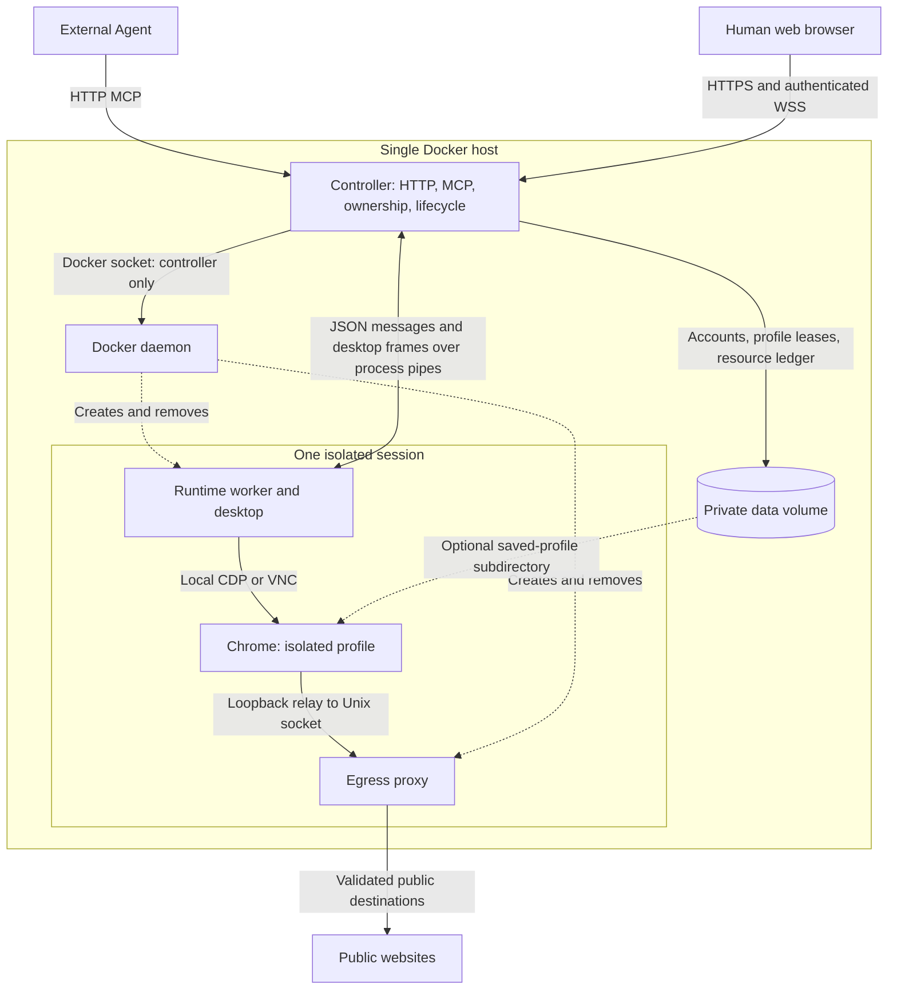
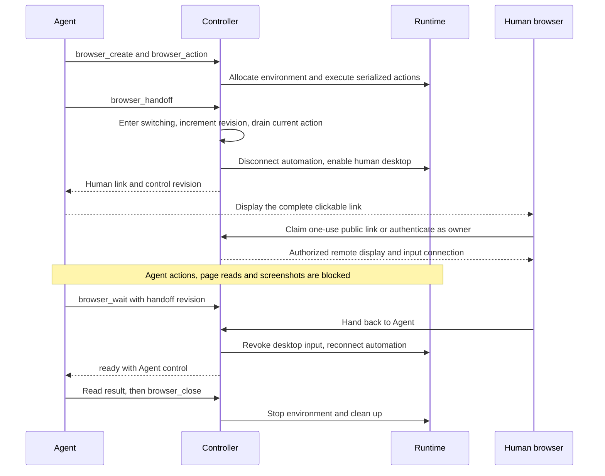
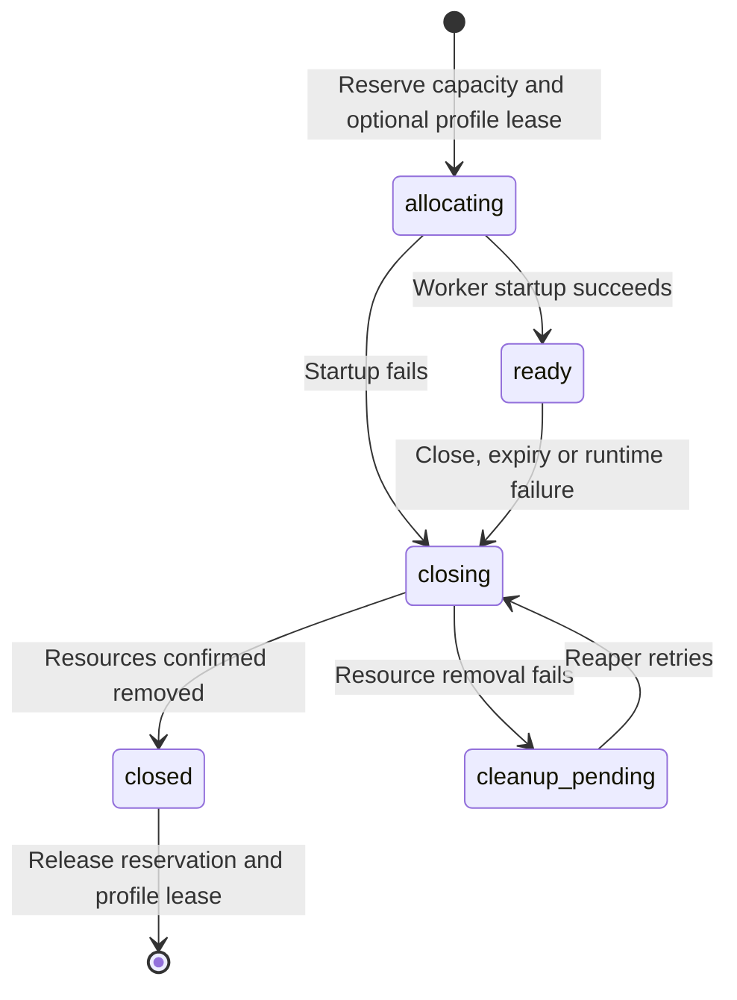

# Technical architecture and contributor guide

Agentic Browser gives an external Agent an isolated browser and lets a person take control when a task needs login, verification or judgment. The Agent supplies the reasoning; this service supplies browser tools, lifecycle management and a remote desktop. There is no embedded LLM, payment service or cloud-provider dependency.

Read [Self-hosting](SELF_HOST.md) to run the published images and [Public demo usage](PUBLIC_DEMO.md) to try the service. This document explains the implemented system, its invariants and where to make changes. [Release maintenance](RELEASING.md) covers GitHub Actions, image publication and acceptance.

## 1. Deployment and trust boundaries

The supported deployment is one controller on one Docker host. The two image repositories are **controller** and **runtime**; the runtime image is used for both browser and egress-proxy containers. A browser session belongs to a task, not to an individual MCP call. Calls reuse its environment until close or expiry.



The reverse proxy, if used, terminates HTTPS and forwards HTTP/MCP and WebSocket upgrades to the controller. Chrome, CDP and VNC are not published as host ports. Docker socket access is daemon-wide authority: it is granted only to the controller, not to an Agent or browser container.

A browser container uses `--network none`. Its loopback proxy relay reaches a Unix socket shared with its own egress container, which uses Docker's bridge network. This is not a direct browser-to-Internet network connection. Offline fixtures can run without an egress container.

## 2. Source map and request path

The controller is TypeScript running on Node.js 24, using the built-in HTTP server, the MCP SDK, Zod schemas and WebSockets. Identity records live in `identity.sqlite` through Node's SQLite API; active session coordination remains in memory. Browser automation uses Playwright/CDP, while the remote desktop uses Xvfb, Openbox, x11vnc and the noVNC web client. There is no separate database server or frontend build framework.

| Module | Responsibility |
| --- | --- |
| `src/main.ts`, `src/config.ts` | Load configuration, choose an engine, bootstrap identity, start HTTP, reap resources and shut down |
| `src/http.ts`, `src/team-http.ts`, `src/http-origin.ts` | Website/API routes, human authentication, origin checks and resource authorization |
| `src/remote-mcp.ts` | Public HTTP MCP, guest leases, per-session keys, one-use human links and source-IP quotas |
| `src/private-mcp.ts`, `src/private-mcp-server.ts`, `src/mcp.ts` | Authenticated HTTP MCP and the optional stdio adapter; shared private tool definitions |
| `src/sessions.ts`, `src/session-wait.ts`, `src/contracts.ts` | Session ownership, capacity, control transitions, serialized actions, waits and validated schemas |
| `src/docker-runtime.ts`, `src/runtime-worker.ts`, `src/runtime-mounts.ts` | Docker allocation, worker RPC, scoped mounts and recovery |
| `src/desktop.ts`, `src/browser.ts` | Chrome/desktop processes, Playwright/CDP automation, tab state and screenshots |
| `src/desktop-gateway.ts`, `src/mirror-grants.ts` | Authorized desktop WebSocket upgrades, one-use grants and connection revocation |
| `src/identity.ts`, `src/profiles.ts` | Accounts, hashed credentials, saved profiles and exclusive profile leases |
| `src/egress-proxy.ts`, `src/egress-policy.ts` | Destination validation, DNS/IP checks and outbound proxying |
| `src/service-status.ts`, `src/doctor.ts` | Bounded diagnostics, version metadata and operator checks |
| `web/` | Plain HTML/CSS/JavaScript: landing page, dashboard, connection page and noVNC viewer |
| `runtime/`, `scripts/`, `.github/workflows/` | Image definitions, asset locks, setup/backup helpers and native acceptance workflows |

`main.ts` initializes the Docker engine before accepting traffic, resolves the selected runtime image to an image ID, acquires the controller lock and reaps abandoned resources for its instance. It then constructs `SessionRegistry`, the identity store and the HTTP server. A periodic reaper retries expiry and cleanup; graceful shutdown stops accepting work and closes owned resources.

Public MCP authorizes a guest lease before calling the registry. Authenticated MCP uses the private HTTP API with the personal Bearer credential; human dashboard requests use the owning account's cookie. Both paths converge on the same session rules and browser contracts.

`BrowserEngine.create()` returns a `BrowserWorkspace`. The Docker implementation sends correlated JSON messages over the worker's stdin/stdout, including desktop stream frames; it exposes no worker RPC network port. `runtime-worker.ts` delegates to the desktop engine, which connects Playwright to Chrome over local CDP. Local Chromium and desktop engines also implement the contracts for development and tests; they do not provide Docker's deployment isolation.

Some internal files and types retain the name `team`. They implement existing account and credential isolation in authenticated mode. The product exposes personal workspaces and a public demo, with no team invitation, role-management or shared-session product flow.

## 3. Human handoff and exclusive control



The control states are `agent`, `human`, `switching` and `closed`. `BrowserSession.run()` serializes work and checks the captured revision before execution and before returning an observation. A transfer fences queued actions immediately, drains the active action, and rechecks authorization around the engine transition. A failed detach/attach closes the session rather than leaving control ambiguous.

The desktop engine disconnects its CDP client during human control while Chrome stays alive. On handback it stops/revokes the human input connection and reconnects automation to the same browser. The controller permits only one active input connection. A viewer reconnect restores access to a still-live session; it cannot revive an expired or restarted browser.

A server-side operation timeout can close the session. Clients must inspect state before retrying an action, especially a form submission. A timed-out `browser_wait` is different: it only ends the wait request and never changes control or extends the session.

## 4. Resource lifecycle and persistence

Control state and resource state are separate. Runtime resources follow this lifecycle:



Capacity includes sessions starting or being cleaned up, not just ready browsers. A failed allocation can still own resources; `BrowserAllocationError` retains that workspace for cleanup. The registry must keep its reservation until closure is confirmed. Likewise, a saved-profile lease is released only after the isolated processes have stopped.

The Docker engine uses instance/runtime labels, a private resource ledger and an exclusive controller lock. Restart recovery removes abandoned resources owned by that instance; it does not replay actions or restore session IDs. Do not run two controllers against the same data directory or remove another instance's containers during cleanup.

| State | Lifetime and access |
| --- | --- |
| Active sessions, action queues, public leases and waiters | Controller process lifetime; invalidated by restart |
| Account records, password hashes and credential hashes | Private identity storage; unavailable to browser containers |
| Saved browser profiles | Explicit opt-in, owned by an account and exclusively leased to one session |
| Temporary browser profiles | Session lifetime; removed with the isolated environment |
| Instance identity, resource records and profile locks | Private durable bookkeeping used for ownership and cleanup |

An Agent credential has explicit saved-profile grants. Creating or deleting profiles is a human/host operation, not an Agent tool. A browser receives only its authorized profile subdirectory, never the whole private volume or identity database. Public mode uses temporary guest identity storage and does not offer saved profiles. Legacy unowned profiles require explicit local ownership migration.

## 5. Authentication and isolation invariants

| Boundary | Enforcement |
| --- | --- |
| Account vs. Agent | Password login produces a human cookie; MCP uses a separate revocable personal token |
| One credential vs. another | Sessions bind both owner and credential; rebinding enters human control and fences the old credential |
| Public visitors | Each session has its own secret; a transport ID or session ID alone grants no access |
| Human viewer | Owning-account login or a short-lived public claim, plus a one-use display grant |
| Browser vs. host | Non-root runtime, read-only root, dropped capabilities, no-new-privileges, sandbox and resource limits |
| Browser vs. other destinations | No direct external route; controlled egress denies internal, metadata and management targets |

Passwords use salted scrypt hashes; Agent secrets are stored as hashes. Human cookies are HttpOnly and SameSite=Strict, with Secure on HTTPS origins. Password changes or account disablement revoke access. Pending waits and operations recheck credentials and session binding. Public APIs expose aggregate capacity, not another visitor's sessions or profiles.

The egress proxy checks resolved destination addresses, rejects private/reserved ranges and disallowed ports, and connects to the validated IP instead of performing a second DNS lookup. The service's own hostname and configured management hosts are denied. Direct UDP/WebRTC egress is unavailable. The synthetic `https://agentic-browser.invalid/demo` fixture has a dedicated mapping; it is not a route to the controller API.

Chrome's sandbox remains enabled. The runtime uses no privileged mode or host networking. `runtime/chrome-seccomp.json` derives from Playwright's profile and permits the setup needed for Chrome's own user-namespace sandbox; it does not grant outer-container `CAP_SYS_CHROOT`.

These boundaries do not hide data from the deployment administrator or guarantee protection against every container escape. After handback, the authorized Agent can read the signed-in site. Website anti-bot checks and login expiry still apply. Reverse-proxy trust must be configured explicitly; several people behind one NAT share the public source-IP quota.

## 6. MCP integration reference

### Transport and authority

| Mode | Endpoint | Authority | Tools |
| --- | --- | --- | --- |
| Public demo | `https://agentic-browser.zkpass.org/mcp` | Session-specific `sessionId` / `sessionKey`; no registration | 9 |
| Authenticated workspace | Your origin plus `/mcp` | Personal Bearer token on every request and credential-owned session IDs | 11 |

Both use Streamable HTTP MCP. A website cookie, transport ID or session ID alone is not Agent authority. Use tool discovery for current schemas. Public tools are `browser_create`, `browser_status`, `browser_action`, `browser_screenshot`, `browser_handoff`, `browser_human_link`, `browser_wait`, `browser_extend` and `browser_close`. Authenticated mode adds authorized session/profile listings.

### Client handoff contract

1. Create a browser and navigate to the task page.
2. Call `browser_handoff` when human input is needed.
3. Display the returned **actual `humanUrl`**, as a clickable link and complete URL, before waiting. Preserve its `#` fragment. Never replace it with the homepage, an incomplete `/connect` link or a session key.
4. The person opens the link, takes control, completes the step and clicks **Hand back to Agent**.
5. Call `browser_wait`, passing the handoff `revision` as `afterRevision` when available. Resume actions only when the response confirms Agent control.
6. Close the browser when the task ends.

Handoff/link tools provide `humanUrl`, `userMessage`, structured content and a separate text message for different MCP clients. Show `userMessage`; do not tell someone to click an undisplayed link. Public links expire after two minutes and are single-use. Obtain a replacement with `browser_human_link`. The fragment is removed after a successful claim. Authenticated workspace links require the owning account's login.

Passwords and verification codes belong in the remote browser, not in the Agent conversation. Keep session keys, tokens and human links private.

### Limits, waiting and errors

Public sessions start with five minutes and have a ten-minute maximum lifetime. The official demo permits five concurrent sessions and two per source IP. Full-capacity creation returns MCP `isError: true`, HTTP-style `status: 429`, `capacity`, `retryAfterSeconds: 30` and an English `userMessage`. Display the count/message and let the user retry; the delay does not reserve a slot. The MCP transport itself can still return HTTP 200 for a failed tool call.

`browser_wait` lasts at most 25 seconds. Cancellation releases its request only. Waiting never renews a session. Authenticated mode permits two concurrent waits per credential and 64 per instance. Its HTTP endpoint is `POST /api/sessions/<id>/wait`, with the personal Bearer token and JSON such as `{"control":"agent","afterRevision":1,"timeoutMs":20000}`; it returns `ready` or `timed_out` with session state.

| Status / error | Client response |
| --- | --- |
| 401 `unauthorized` | Replace the expired/revoked personal token; do not substitute a human cookie |
| 404 `session_not_found` | Treat the session as absent or outside this credential's authority |
| 409 control errors | Stop conflicting actions; inspect control state |
| 410 `session_ended` | Create a new session if needed; old links cannot revive it |
| 429 capacity/wait limits | Show the limit and reduce requests or retry later |
| 503 `runtime_stopped` | Wait for cleanup before reopening a session/profile |
| 504 operation/runtime timeouts | Inspect state; do not blindly repeat a potentially completed action |

The optional stdio adapter uses `AGENT_BROWSER_URL`, `AGENT_BROWSER_TOKEN` and optional `AGENT_BROWSER_VIEW_URL`. It forwards to the authenticated HTTP API. A remote adapter container needs no Docker socket or server-volume mount; the compatibility command `scripts/release-compose.sh mcp-remote` uses the pinned controller image. Ordinary HTTP MCP clients do not need it.

## 7. Developing and contributing

Use Node.js 24+, npm, Python 3, Bash and a local Docker daemon. With source access:

```sh
npm ci
npm run check
npm test
bash scripts/build-container-images.sh
cp .env.example .env
# Set AB_ADMIN_PASSWORD before the first authenticated startup.
bash scripts/compose.sh up -d --wait
```

Keep an existing `.env` instead of overwriting it. Use disposable test installations; never point acceptance fixtures at a real workspace. `output/` holds ignored logs/screenshots, while `.deployment/` holds persistent official-site setup files. Neither belongs in a source contribution.

| Change | Start here and verify |
| --- | --- |
| Add a browser action | `contracts.ts`, `browser.ts`, worker/engine forwarding; validate inputs and exercise both control states |
| Change handoff or waiting | `sessions.ts`, gateway and MCP layers; test concurrent actions, stale revisions, revocation and reconnect |
| Change storage or cleanup | `profiles.ts`, `docker-runtime.ts`; test failed allocation, failed deletion, restart recovery and retained locks |
| Change auth or quotas | HTTP/MCP identity boundaries; test cross-account/credential denial and pending operations |
| Change network policy | `egress-policy.ts` and proxy; test blocked addresses, DNS behavior and every outbound path |
| Change website or docs | `web/`, static download routes and packager; verify rendered links and source-free setup contents |
| Update Chrome/extensions | Reviewed asset locks, clean runtime build and the runtime/backup acceptance in [Releasing](RELEASING.md#browser-assets-and-runtime-builds) |

Run targeted unit/API tests for behavioral changes, then the relevant disposable integration checks from [Acceptance commands](RELEASING.md#acceptance-commands). Native browser tests additionally need `npm run browser:install` and `npm run desktop:install`. Tests use synthetic identities and website data, never real credentials.

Keep ownership and control checks in the shared layers. New MCP tools must not accept arbitrary Docker arguments, host paths or per-session images. Do not expose raw browser/daemon errors containing page data. Review a contribution with its concrete behavior, failure paths and verification results; preserve third-party notices and dependency licenses.

## 8. Images and compatibility

Controller/runtime images support native Linux amd64 and arm64. macOS uses Docker Desktop's Linux VM. The runtime contains locked Chrome and original signed zkPass extension packages, installed locally into fresh profiles; it is never produced by committing a user's signed-in browser. Startup validates bundled extension readiness. Live proof success is outside the verified browser contract.

Image choice is instance-wide. Immutable version tags and digest pins make deployments reproducible from published artifacts; only `latest` moves between stable releases. Updating Chrome or profile formats requires explicit backup and migration acceptance. See [Releasing](RELEASING.md) for asset maintenance, workflow permissions and version promotion, and [Self-hosting](SELF_HOST.md#backup-and-upgrade) for operator procedures.
