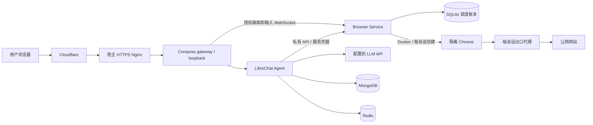

# Agent 架构

当前产品是完整 LibreChat Agent：用户在聊天旁查看独立 Chrome，人工接管完成登录或验证，归还控制后任务自动继续。浏览器能力通过原生 Agent tools 调用私有 HTTP 服务。

## 项目边界

| 目录 / 项目 | 职责 |
| --- | --- |
| `integrations/librechat/`（上游版本锁与定制补丁） | 聊天界面、本地账号、Turnstile、Qwen、原生工具、credits、全站预算、管理员入口和密码找回 |
| `src/api/` | 内部浏览器协议与控制 API |
| `src/scheduling/` | SQLite 队列、每用户配额、会话控制状态机、恢复事件和资源回收 |
| `src/streaming/` | 一次性 viewer grant、画面与人工输入 WebSocket |
| `src/docker-runtime.ts` | 创建、隔离和清理 Chrome / egress 容器 |
| `src/runtime-worker.ts`、`src/desktop.ts`、`src/browser.ts` | 容器内 Chrome、扩展、CDP 和 VNC 生命周期 |
| `src/egress-*` | 公网出口代理与目标地址限制 |
| `deploy/agent/` | 完整 Agent 的 Compose 安装、配置、备份、恢复和升级 |
| `runtime/` | Chrome 镜像构建、扩展版本锁定、沙箱规则及许可证 |
| `scripts/build/` | 资源下载、镜像构建、发行打包与 GHCR 发布 |
| `test/acceptance/` | 完整 Agent、运维和浏览器验收；`fixtures/` 保存模拟模型、邮件和测试账号工具 |

## 请求与身份

浏览器访问 gateway → LibreChat。LibreChat 验证登录账号，从服务端会话生成用户、对话和任务标识，使用内部服务密钥调用 Browser Service。入口代理清除访客提供的身份头；仅传 `X-User-ID` 无法绕过服务验证或任务归属检查。

控制 API 不向公网开放。画面和输入仅开放两个精确 WebSocket 路径，由 LibreChat 签发的短时、一次性授权约束用户、任务、角色和控制版本。Agent 运行时允许观察；人工接管期间禁止 Agent 操作和观察，CDP 断开。归还时重新接入同一个 Chrome，再由持久化事件驱动 Agent 继续。过期连接和旧版本操作失效。

## 会话与资源

每用户最多一个未结束的 lease，包括排队、启动、运行和等待清理。SQLite 事务保证全局容量和 FIFO 队列；只有确认容器消失后才释放名额。全局硬上限 10，部署默认 1，实际放行量由配置决定。默认会话 5 分钟、绝对上限 10 分钟，排队最多 10 分钟。已确认的结束记录默认保留 24 小时，未确认事件保留以供恢复。

每个 lease 使用一次性 Chrome 容器及临时用户目录。网站登录、扩展存储在同一次接管前后保留，会话销毁后不保留。浏览器服务复用 LibreChat 的用户身份，不另设账号系统或跨会话浏览器档案。

Chrome 无 Docker socket、模型密钥或数据库卷，根文件系统只读、无直连网络、无公开 CDP/VNC 端口。只有本会话出口 socket 子目录以只读方式挂入 Chrome。出口代理拒绝私网、loopback、云元数据和站点自身地址；不内置可绕过代理的 Demo 网页。

## 数据与成本

MongoDB 保存 LibreChat 账号、密码摘要、聊天、个人 credits、全站预算和账单记录；Redis 保存流、恢复状态及短期缓存；Browser Service 使用独立 SQLite 保存调度和事件。默认新账号 200,000 credits、全站每日 20,000,000 credits。模型费率用于扣账，已有账号额度和管理员修改的预算不会被 bootstrap 覆盖。

站点管理员可以管理账号、额度和预算。模型接收提示及工具结果；用户应在远程浏览器中输入网站密码和验证码。部署者控制服务器及所存数据。

## 部署

所有部署使用同一套完整 Agent Compose，见 [部署指南](DEPLOYMENT.md)。宿主 Nginx 将域名转到 gateway 的回环端口；Mongo、Redis、浏览器状态与应用文件绑定安装目录的 `data/`，重建容器保留数据。配置和密钥通过 `--config-directory` 指定位置，源码部署使用根目录 `config/local/`；Compose 通过 `AGENT_CONFIG_DIR` 挂载同一目录的 secret 和只读配置；`agentctl.mjs` 生成 Compose 插值文件并管理生命周期。对应关系见 [配置](CONFIGURATION.md)，备份恢复见 [运维](OPERATIONS.md)。

官方公网安装路径统一为 Cloudflare DNS/代理 → 宿主 HTTPS Nginx（Full strict）→ Compose gateway，公开注册使用 Turnstile。这样统一入口模板和验收，不给应用增加 Cloudflare DNS/证书管理 SDK、Tunnel 服务或另一套 Compose。关闭注册只是本地账号系统的策略开关，保留自用和隔离验收能力。

密码找回共用一套 TLS SMTP 实现，官方指南提供 Cloudflare Email Sending 配置；发信服务不是核心启动的硬依赖。源站证书归宿主，模型与应用密钥归安装目录，构建和发布均不依赖这些部署参数。

`deploy/` 是版本控制中的部署源码，`.deployment/` 是不提交的本地运行状态和数据，根目录 `config/local/` 保存本机配置；两者均可由新 clone 的安装工具初始化。构建日志和报告在 `output/build/`，临时验收安装在 `output/tests/`。完整目录约定见 [文档导航](README.md)。

发行清单包含 Agent、Browser Service、Chrome runtime、gateway、MongoDB、Redis 六个不可变镜像。Chrome runtime 由 Browser Service 按会话启动，并非常驻 Compose 服务。源码工具将管理 CLI 及其依赖编译为独立 Node 文件；源码准备、镜像构建、GHCR 上传和安装包制作分别见 [开发](DEVELOPMENT.md)、[构建](BUILD.md) 和 [发布](RELEASING.md)。已验收平台和剩余工作见 [当前状态](STATUS.md)。
