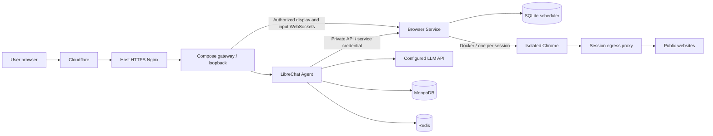

# Architecture

Agentic Browser is a complete LibreChat-based Agent. A user sees an isolated Chrome session beside chat, takes control for sign-in or verification, then returns control so the task can continue. Native Agent tools call a private HTTP Browser Service.

This diagram shows the documented public deployment. Private use can reach the loopback gateway through an SSH tunnel without Cloudflare or host Nginx.

## Component boundaries

| Path | Responsibility |
| --- | --- |
| `integrations/librechat/` | Upstream lock and patch for chat, browser panel, accounts, Turnstile, model configuration, tools, credits, budgets, administration and password recovery |
| `src/api/` | Internal browser protocol and control API |
| `src/scheduling/` | SQLite queue, account quotas, control state, resume events and resource cleanup |
| `src/streaming/` | Single-use viewer grants, display and human-input WebSockets |
| `src/docker-runtime.ts` | Creation, isolation and cleanup of Chrome and egress containers |
| `src/runtime-worker.ts`, `src/desktop.ts`, `src/browser.ts` | Chrome, extensions, CDP and VNC lifecycle inside the runtime |
| `src/egress-*` | Outbound proxy and destination restrictions |
| `deploy/agent/app/` | Configuration, initialization, email and account operations inside the Agent image |
| `deploy/compose/` | Compose template, backups, restores, upgrades and scheduled operations |
| `deploy/agent/` | Dockerfiles, host Nginx template and shared process/archive tools |
| `runtime/` | Chrome image, pinned assets, sandbox rules and licenses |
| `scripts/build/` | Source preparation, image builds, GHCR publication and delivery files |
| `test/acceptance/` | Complete application and operations acceptance; fixtures provide model and mail simulations |

## Identity and control

The gateway forwards application requests to LibreChat. LibreChat authenticates the account, derives user/conversation/task identifiers on the server and calls the Browser Service with an internal service credential. The edge proxy removes visitor-supplied identity headers. Sending `X-User-ID` alone does not bypass authentication or task ownership checks.

The control API is not published on a host port. Display and input use two explicitly routed WebSocket endpoints. Short-lived, single-use grants bind access to a user, task, role and control version. During human control, Agent observation and actions are suspended and its automation CDP connection is disconnected. Returning control reconnects to the same Chrome session; persisted events resume the Agent. Old grants and operations from a previous control version are rejected.

## Sessions and resources

Each account can hold one unfinished lease, including time spent queued, starting, active or awaiting cleanup. SQLite transactions enforce capacity and FIFO admission. A slot is released only after container removal is confirmed. The deployment default is one active browser, with a configurable ceiling of ten. The service defaults to a five-minute session deadline, a ten-minute absolute lifetime and a ten-minute queue timeout. Ended records are retained for at least 24 hours; unacknowledged events and live resources are retained for recovery.

Every lease has a disposable Chrome container and browser profile. Sign-in and extension state survive a handoff within that session, but are removed when the session is destroyed. Browser identity comes from LibreChat; there is no second account system or persistent cross-session browser profile.

A follow-up in the same chat receives a new task identity after the previous task ends and opens a fresh browser. Historical lease IDs cannot be reused across tasks. Agent instructions include the current task ID, and stale-lease tool errors explain how to open a new browser in the existing chat. A task that needs sign-in must call the handoff tool to pause for human input; a text-only final reply ends the generation and releases its browser.

Chrome has no Docker socket, model key or database volume. Its root filesystem is read-only, it has no direct network connection, and CDP/VNC ports are not published. A read-only mount exposes only that session's egress socket directory. The proxy rejects private addresses, loopback, cloud metadata and the application's own origin. Browser Service and operations containers do have Docker access and are part of the trusted host-management boundary.

The origin restriction matches the hostname (including case and trailing-dot variants). Other hostnames may use the same public CDN IPs; sharing a Cloudflare address does not make a website a management endpoint. Direct-IP requests are also checked against the origin's resolved addresses, failing closed if that lookup fails. Explicitly denied IPs apply to named destinations too. All destination DNS answers must be public, and connections use the checked address without a second lookup. Hostname filtering is defense in depth: it does not identify every alias or inspect the hostname inside a TLS tunnel. Management security relies on authenticated APIs and isolation, not ownership of a shared CDN address.

Because the container has only loopback, Chrome would otherwise report `navigator.onLine = false` even when its proxy works. A separate, container-local CDP connection installs a fixed bootstrap in pages and frames before site scripts run, including after reload and in new targets during human control. The bootstrap makes the page’s `navigator.onLine` getter report the configured proxy transport. Initialization and resume commands are queued in order without waiting for individual responses: link-created tabs and `window.open` renderers can defer initialization responses until resumed. Chromium’s native network-state override is unsuitable here because other CDP sessions clear it on navigation or disconnect. Page lifecycle events are discarded locally. This connection does not subscribe to traffic, request page content, or execute Agent instructions; the bootstrap contains no user input and reads no data. It does not change worker globals. It closes with the runtime, and an unexpected failure closes the workspace. The online indicator means a proxy transport is configured, not that every destination is reachable; normal request failures and egress restrictions still apply.

WebGL uses Mesa llvmpipe through ANGLE, rendering on the CPU without exposing host GPU devices. Chrome's software-renderer blocklist is overridden for this fixed runtime environment; Chrome’s renderer sandbox and container resource limits remain enabled. Graphics-heavy pages can consume more CPU or render more slowly than on a desktop GPU. Runtime acceptance checks actual WebGL drawing, online state across handoff/reload/new tabs, and continued network isolation.

## Data and usage accounting

MongoDB stores accounts, password hashes, conversations, personal credits, site budgets and billing records. Redis stores streams, resume state and short-lived cache data. Browser Service keeps scheduling and events in a separate SQLite database.

Defaults are 200,000 initial credits per account and 20,000,000 credits per site day. One million credits represents one US dollar in application accounting. Charges use operator-supplied model rates; bootstrap preserves existing balances and administrator-saved budgets. This accounting does not replace the provider's billing controls.

Each model request reserves a conservative cost before reaching the provider, then settles against the reported usage. Missing usage retains the reservation. The byte-based estimate is used only for cost reservation; LibreChat manages the model context window separately. The demo limits serialized requests to 256 KiB and output to 4,096 tokens. Request-size, context-window and daily-budget failures are distinct.

Administrators manage accounts, balances and the daily budget. The model receives prompts and tool results, which may include signed-in page contents. Users enter website passwords and one-time codes during human control, rather than in chat. The deployment operator controls the server and stored data.

## Deployment and recovery

[Deployment](DEPLOYMENT.md) uses one Compose definition. Persistent data and generated configuration live in project-specific named volumes. Operators supply `settings.json` and `secrets.env`, optionally in an external `AGENT_CONFIG_DIR`. The initializer generates identity keys on first startup and preserves them on subsequent starts. None of these operator inputs is needed to build an image.

The on-demand `ops` container and optional daily `backup` service share an operating-system lock. Backup closes the gateway, drains requests, checks for browser tasks, stops writers, then archives persistent data and input configuration. Only verified archives become completed backups. The operations state volume tracks interrupted work separately from backed-up application data.

Restore normally targets a new project. An upgrade takes a full backup and verifies the new services; failure leaves maintenance enabled. Rollback restores both the previous Compose version and its data. A restart alone is not proof that an interrupted restore or upgrade is safe to resume. See [Operations](OPERATIONS.md).

The documented public entry is Cloudflare DNS/proxy, Full (strict) HTTPS to host Nginx, then a loopback Compose gateway. Public registration requires Turnstile. Closed registration uses the same account system. TLS SMTP is optional; the guide gives Cloudflare Email Sending settings, and the implementation also supports other TLS SMTP providers.

A release pins six images: Agent, Browser Service, Chrome runtime, gateway, MongoDB and Redis. Compose pulls the runtime image through a one-shot service; Browser Service creates the actual Chrome containers per session. The Agent image contains the bundled operations program, Docker CLI and Compose plugin, so deployment hosts do not need Node/npm.

See [Build](BUILD.md), [Release](RELEASING.md) and [repository layout](DEVELOPMENT.md#repository-layout) for tooling boundaries. Release notes and their attached reports record verification coverage.
