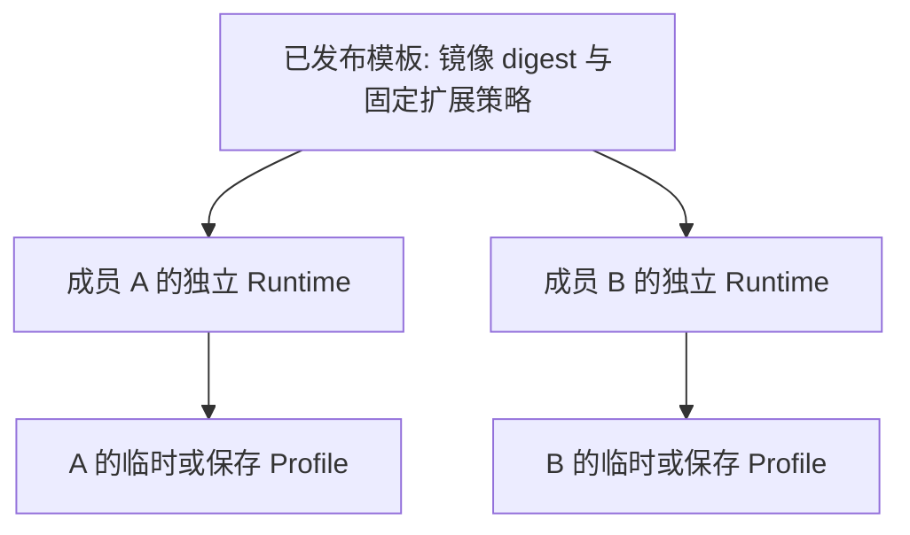

# 固定 Chrome 扩展与自定义运行镜像设计

更新日期：2026-10-13，北京时间。状态：E0 原型已构建并通过断网验收；E1 已通过 Schema Validator 合成接口捕获和交还，真实 TransGate 证明及完整失败/取消路径仍待验收。运行方式见 [镜像原型说明](../runtime/README.md)。E2 已接入实例级不可变镜像 ID 和每 Session 扩展就绪门禁；E3 已有本地源码归档和干净构建，跨版本升级/回退与正式发布仍待验收。

目标是在远程 Ubuntu Chrome 中固定提供 zkPass TransGate 与 zkPass Schema Validator。创建 Session 时选择管理员发布的浏览器环境版本，自动准备这两个扩展；每位成员的账号、扩展设置和验证数据仍放在自己的临时或保存配置中。

根据用户对“装好两个扩展后构建镜像，每次从该镜像创建环境”的进一步说明，优先采用“镜像内置两个原始扩展包 + 本地安装注册 + 私有 Profile”。新 Session 不需要再次从商店下载这两个包，但仍需在自己的浏览器目录中完成安装注册和初始化。管理员可先手动试装再发布镜像；已有会话里的个人登录数据不进入共享镜像。

本设计补充 [会话与镜像管理设计](SESSION_AND_MIRROR_DESIGN.md)，实施状态见 [进度记录](PROGRESS.md)。

## 指定扩展与已核对事实

| 扩展 | 商店 ID | 本轮取得的包版本 | Manifest | 需要关注的声明 |
| --- | --- | --- | --- | --- |
| [zkPass TransGate](https://chromewebstore.google.com/detail/zkpass-transgate/afkoofjocpbclhnldmmaphappihehpma) | `afkoofjocpbclhnldmmaphappihehpma` | `0.5.5` | V3 | `activeTab`、`tabs`、`storage`、`scripting`、`webRequest`、`offscreen`；网站权限为 `<all_urls>`。 |
| [zkPass Schema Validator](https://chromewebstore.google.com/detail/zkpass-schema-validator/kpcbjghknfclbkejkdllpjhhheppaoca) | `kpcbjghknfclbkejkdllpjhhheppaoca` | `0.1.3` | V3 | `debugger`、`activeTab`、`tabs`、`scripting`；网站权限为 `<all_urls>`。 |

上述元数据最初从官方更新端点取得的 CRX 清单核对；后续已在隔离镜像中安装并运行自动验收。当前锁文件固定 Chrome `155.0.8059.39` 和表中两项版本，宿主机 Chrome 策略未修改；真实证明及跨版本兼容另行验收。

zkPass 官方文档分别链接上述 TransGate 和 Schema Validator ID；选择依据为官方链接与固定 ID，不仅匹配名称。[TransGate 快速开始](https://docs.zkpass.org/developer-guides/js-sdk/quick-start)、[自定义 Schema](https://docs.zkpass.org/developer-guides/js-sdk/schema/custom-schema)。

## 方案选择

| 方式 | 新 Session 如何获得扩展 | 适用情况与限制 |
| --- | --- | --- |
| A. 镜像内置在线安装策略，备选 | 镜像启动 Chrome，由策略从官方商店安装两项；安装就绪后才开放正常任务。 | 不复制个人 Profile；首次启动需要联网下载，不能承诺离线或立即就绪。 |
| B. 干净环境手动安装，再发布环境版本 | 管理员通过镜像操作完成试装，导出两项 ID 和允许的非敏感配置，再由干净构建流程生成内置扩展包的 C 类镜像。 | 满足“安装一次，之后统一使用”的体验；发布物是镜像与配置清单，不是整个工作会话的快照。 |
| C. 镜像带经过验证的原始扩展包，当前优先 | 从镜像内的只读包安装至每个私有 Profile，包版本和签名身份单独记录。 | 新建环境无需重复下载；优先验证本地 CRX 安装、策略配合和两个扩展功能，再发布镜像。 |
| D. 复用本人保存配置 | 下次仍使用本人的 Profile，保留已安装扩展及其个人状态。 | 适合个人连续使用；不能把这份配置当作团队共享镜像。 |

本轮将 C 提升为首版优先方案，B 是它的制作入口；A 保留为备选，若原型失败需明确记录原因，不静默改为每次从商店下载。Chrome 官方支持 Linux 外部扩展安装及本地 CRX 安装，但具体包来源、更新和版本行为仍需原型验证。[Linux 扩展安装说明](https://developer.chrome.com/docs/extensions/how-to/distribute/install-extensions)。

## 预装镜像的具体结构

镜像内置两项原始签名 CRX、版本和摘要，以及只读安装描述；构建时在干净测试 Profile 中安装并检查，通过后丢弃该测试目录。发布时不需要用户再次访问商店。

```text
自定义镜像
  Chrome + Xvfb + noVNC 依赖
  extensions/<扩展 ID>/<版本>.crx
  每个扩展的本地安装描述
  扩展允许清单与启动检查

新 Session
  复用镜像的只读软件
  创建自己的运行目录
  创建或挂载本人 Profile
  本地注册扩展、检查就绪
```

Linux 本地安装原型采用官方的 external preferences：在 `/opt/google/chrome/extensions/` 下放置以扩展 ID 命名的 JSON，`external_crx` 指向镜像内的绝对路径，`external_version` 与原始包一致。例如 TransGate 的描述文件为 `afkoofjocpbclhnldmmaphappihehpma.json`：

```json
{
  "external_crx": "/opt/agentic-browser/extensions/afkoofjocpbclhnldmmaphappihehpma/0.5.5.crx",
  "external_version": "0.5.5"
}
```

另一项采用相同结构和自己的 ID、版本。策略对两项设为 `allowed`，对其他用户扩展设为 `blocked`，固定工具栏图标；安装由本地描述文件触发。该组合已通过 E0 断网验收。`allowed` 不等于不可禁用或移除；启动验收必须确保两项均存在且启用。若还要求运行期间无法移除，需要另行验证受控更新源与强制安装的组合，不能直接混用下面的在线策略并宣称不再联网下载。

首次本地注册仍属于 Session 的准备阶段。扩展目录、安装登记、个人设置都与 Profile 有关，只把某个已经运行过的 Chrome 容器做快照，不能保证换一个空 Profile 后仍可用。即使从未登录，试装时也可能产生安装标识和扩展存储，因此按软件包重建，不复制试装 Profile。

本地安装验收将暂时阻断商店下载网络，确认两个扩展仍能注册和启用；这只验证安装不依赖商店，不代表 zkPass 的业务验证可以离线进行。

## 在线安装备选策略

在每个隔离 Runtime 内提供只读策略文件 `/etc/opt/chrome/policies/managed/agentic-browser.json`。这是 Google Chrome 在 Linux 上的策略目录；普通浏览器用户不得修改，避免跨会话改写。策略由单一清单生成，避免多个文件给同一策略赋冲突值。[Linux 策略配置](https://support.google.com/chrome/a/answer/9027408?hl=en)。

以下仅用于方案 A 的在线安装对照，不是方案 C 的本地包安装配置，也未写入服务器：

```json
{
  "ExtensionSettings": {
    "*": {
      "installation_mode": "blocked"
    },
    "afkoofjocpbclhnldmmaphappihehpma": {
      "installation_mode": "force_installed",
      "update_url": "https://clients2.google.com/service/update2/crx",
      "toolbar_pin": "force_pinned"
    },
    "kpcbjghknfclbkejkdllpjhhheppaoca": {
      "installation_mode": "force_installed",
      "update_url": "https://clients2.google.com/service/update2/crx",
      "toolbar_pin": "force_pinned"
    }
  }
}
```

默认禁止其他用户安装的扩展，两项指定扩展自动安装并固定工具栏入口。`force_installed` 表示用户不能自行移除；如果以后希望可以禁用，可改为 `normal_installed`，但那不属于本轮建议默认值。此处“固定两个”指用户扩展，不计算 Chrome 自带组件。[ExtensionSettings 字段说明](https://support.google.com/chrome/a/answer/9867568?hl=en)。

本项目继续使用普通 Chrome 原生桌面模式。正式 Chrome 从 137 起移除了通过 `--load-extension` 加载扩展的能力，因此不把该启动参数作为商店扩展安装路径，也不为此切换现有浏览器品牌。[Chromium 官方公告](https://groups.google.com/a/chromium.org/g/chromium-extensions/c/1-g8EFx2BBY/m/S0ET5wPjCAAJ)。

## 镜像、环境版本和个人数据

在已有 Runtime/Profile 模型上增加管理员发布的 `BrowserTemplate`，表示一份可创建会话的环境版本。

| 对象 | 保存内容 | 可见与使用范围 |
| --- | --- | --- |
| 运行镜像 | Chrome、桌面依赖、启动组件、两个原始扩展包、本地安装描述及扩展策略。 | 管理员发布的只读软件制品。 |
| BrowserTemplate | 模板 ID/版本、镜像 digest、两项扩展 ID/包版本/摘要、策略摘要、允许的网络及资源要求、验收状态。 | 成员/Agent 只选择已获授权且已发布的模板；不能提交任意镜像地址、启动命令或挂载路径。 |
| Runtime | 实际镜像 digest、模板版本、Chrome 版本、实际扩展版本与准备状态。 | 当前 Session 独占的可写环境。 |
| 私有 Profile | 网站登录、扩展本地设置和授权数据；内容由 Chrome 和扩展决定。 | 临时模式结束清理；保存模式归所属成员，继续受配置独占锁限制。 |
| 会话产物 | 用户保存的 Schema 草稿、导出文件或明确保留的结果。 | 按会话及所有者管理；不自动成为共享镜像的一部分。 |

建议管理员维护少量已发布版本，例如 `zkpass-default@1`；创建会话默认使用实例指定版本，也可选择获授权的历史版本。`templateId` 是待新增能力，当前 API 尚不支持。



软件和非敏感预设可以共用，Profile 可写目录不能共用。扩展可能使用 local、sync、session 等存储；清空浏览历史不能视为清空扩展数据。本轮两个安装包均未声明 `storage.managed_schema`，暂不承诺能够用企业策略预填扩展内部设置。后续若扩展支持该接口，再纳入清单。[Chrome 扩展存储说明](https://developer.chrome.com/docs/extensions/reference/api/storage)。

## “我装好以后生成镜像”的具体流程

1. 管理员创建一次专门的制作会话，使用干净 Runtime，无业务 Profile、服务令牌或团队共享钱包。成员自己的业务会话不提供“发布成共享镜像”入口。
2. 在远程画面中安装、打开两项扩展，检查工具栏和页面联动。需要账号的试用只在独立验收会话中完成。
3. 系统记录扩展 ID、实际版本、原始包来源与摘要、Chrome 版本及允许的公开预设，形成构建清单；不复制制作会话的 `user-data-dir`、下载、历史、扩展存储或密钥材料。
4. 构建服务从干净基础镜像生成包含 Chrome、两个原始扩展包、本地安装描述和策略的候选镜像；保留原签名和 ID，不从安装目录重新打包签名。制作会话的容器管理权限不暴露给浏览器；发布仅由管理员完成。
5. 从候选镜像启动两个全新验收会话，确认都具备扩展且没有制作人员的登录状态，验证交接及隔离。
6. 验收通过后发布新的模板版本并设置默认值。新 Session 使用该版本，正在运行的 Session 保持原环境。

这一路径把手动试装转成可重复构建。只删除 Cookie 后再把整个环境打包，不能证明扩展存储或其他浏览器数据已清空；首版不采用对业务容器直接做快照发布的方式。

镜像中也不预置 DevHub 登录、数据源登录、API 密钥或钱包。需要保留本人配置时走原有的私有 Profile 流程。

## Session 创建与扩展就绪

在原有生命周期中，扩展准备属于 `allocating` 的子阶段，不能以 CDP 端口可连接就判定整个环境就绪：

```text
授权模板与 Profile
  → 分配 Runtime
  → 启动 Chrome
  → 应用并校验策略
  → 从镜像内原始包注册两个扩展
  → 校验安装、启用及所需能力
  → Session ready
```

准备阶段显示“正在准备浏览器扩展”，计入创建中并发配额，并有独立超时、取消与清理流程。失败返回明确的安装、策略、兼容或网络错误；不能静默降级成缺少其中一个扩展的正常会话。

启动检查至少确认两项 ID、启用状态和实际版本。仅存在扩展目录或观察到一个 service worker 不足以证明可用。版本级验收还需检查弹窗和业务入口；具体自动检测方法由原型确定，不通过额外安装第三个诊断扩展解决。

TransGate SDK 提供 `isTransgateAvailable()`，可在适用且已配置的验收页面检测与页面的联动；这不代表已生成或验证证明，也不能检测另一项扩展是否可用。[zkPass API 文档](https://docs.zkpass.org/developer-guides/js-sdk/api-references)。

准备检查只在无用户输入的初始化阶段，或正常 Agent 控制阶段按权限执行；人工接管期间不为健康检查偷偷重连 CDP 或读取页面。

## 与 Agent 和人工交接的配合

首版验收范围是“两个扩展安装可用，人在远程镜像中可以操作，结束后 Agent 可继续”。现有 Agent 工具针对网页内容，并没有点击 Chrome 工具栏扩展弹窗的通用能力。直接操作扩展内部 UI 或集成 SDK 属于下一层功能，不能以安装成功代替。

### Schema Validator

其安装包声明 `debugger` 权限，而当前 Agent 使用 Playwright/CDP；二者可能争用同一标签页的调试与网络状态，已通过 CDP 断开期间捕获合成接口并交还的成功路径；真实业务、失败与取消路径仍待补测。Chrome 官方将 `chrome.debugger` 描述为调试协议的另一种连接方式。[debugger API](https://developer.chrome.com/docs/extensions/reference/api/debugger)。

首版支持流程：Agent 准备网页 → 请求人工接管 → 本服务断开 CDP → 人在镜像中启动并完成 Schema 校验 → 人明确交还 → 服务恢复 Agent 连接。关闭弹窗不直接等同于扩展结束调试；需验证扩展完成、取消和失败后的释放行为。若交还时仍有冲突，返回明确错误并停止恢复动作，不能强制抢占或假定校验已经完成。

当前实现交接失败会关闭会话；如需新增“交还失败后留在人工阶段重试”，必须先证明失败的 CDP 连接已完全撤销，再改变状态机，不能在本设计中将其写成现有能力。

官方 Schema 流程从 DevHub 发起，打开数据源页面并返回校验结果；因此还要验收弹出的新页面、回到 DevHub、失败提示与人工取消。是否提交或发布 Schema 由任务范围决定，不作为浏览器安装测试的自动步骤。[Schema 创建流程](https://docs.zkpass.org/developer-guides/js-sdk/schema/quick-start-for-creating-custom-schema)。

### TransGate

安装就绪与真实证明生成分别验收。真实流程还依赖应用配置、Schema、数据源账号及 zkPass 节点连通性；DApp 域名需符合其项目配置。原型采用专门测试项目和可公开测试数据，不将一次安装检查描述成 zkTLS 已跑通。[TransGate 快速开始](https://docs.zkpass.org/developer-guides/js-sdk/quick-start)、[工作流程](https://docs.zkpass.org/developer-guides/js-sdk/how-it-works)。

如果以后让 Agent 发起验证，应通过已确认的页面或官方 SDK 完成，并继续遵守控制权和成员归属；结果校验由接收应用完成。本轮不改写两项扩展，也不接入另一套内置 AI Agent。

若 DevHub 的登录流程需要额外钱包能力，原型先确认官方提供的可用方式；不能为了完成试验默默增加第三个扩展或预置共用钱包。

### 隐私与运行边界

人工接管暂停的是本服务的 Agent 连接，不会自动停止已安装扩展的内容脚本、网络监听和数据处理。两项扩展都声明广泛网站权限，使用它们即包含对其行为的信任；镜像隔离负责阻止不同成员互相访问，不承诺本会话内扩展看不到页面。

两项扩展的实际外联、保存数据和后端账号仍须按真实流程核对。不同 Profile 无法阻止用户主动登录同一个外部账号或把结果提交至同一个项目，因此默认分别使用个人账号和授权项目。ZK 证明也不意味着远程宿主机管理员无法接触浏览器中的原始数据。

不要为了限制 Schema Validator 而直接套用扩展 `runtime_blocked_hosts` 后假定调试仍可用：当前 Chrome 文档说明这一策略可能整体阻止 `debugger.attach`。宿主机及跨 Session 隔离仍在 Runtime 网络与文件边界执行，扩展权限收紧另行测试。[debugger 策略限制](https://developer.chrome.com/docs/extensions/reference/api/debugger)。

## 联网、更新与回退

- 方案 C 在构建或更新镜像时取得原始包，新建 Session 从镜像本地注册；方案 A 才在每次缺少扩展时联网下载。两者的业务流程都仍需 DApp、DevHub、数据源和 zkPass 节点。原型记录必要目标和协议再配置出网，不能仅放行商店页面就认为验证可用，也不因此开放宿主机管理网。
- 方案 C 的镜像 digest 还固定了随镜像附带的扩展包版本，但扩展自己的更新仍可能产生更高的实际版本；“镜像版本固定”不等于“运行期间扩展版本永久固定”。记录会话实际使用版本，变化后重新验证兼容。
- `minimum_version_required` 是最低版本门槛，不是锁定版本。内置本地包先解决安装时重复下载的问题；若还需要严格版本固定，须进一步验证受控更新渠道与保存 Profile 的版本行为；不能直接修改 manifest 或重新签名后假定仍是同一个扩展。
- 计划中的镜像发布只影响新会话，但不能据此保证 Chrome 自己的扩展更新不会发生在长会话中。验证中遇到扩展重载应显示失败或中断，保留正确控制权，不自动再次提交证明或 Schema。
- 模板回退只决定新建环境使用哪个版本，不保证保存配置或扩展本地数据可向旧版本降级。复用 Profile 前做兼容检查，必要时由所有者恢复其私有备份。

官方有通过管理控制台固定扩展版本的方案及适用限制；首版自部署不以接入该云管理服务为前提，也不把它当作本地 JSON 已支持的能力。[版本固定说明](https://support.google.com/chrome/a/answer/11190170?hl=en)、[更新字段说明](https://support.google.com/chrome/a/answer/9867568?hl=en)。

公共演示如使用这两项扩展，也必须走自己的隔离 Runtime 和网络策略。内置虚构登录演示不能自动称为真实 zkPass 证明演示；后者需单独准备测试 Schema、项目及允许的数据源。扩展带来的依赖不改变公共实例不承载真实业务的定位。

## 实施顺序与验收

| 批次 | 内容 | 验收条件 |
| --- | --- | --- |
| E0 兼容原型 | 在独立测试环境验证镜像内原始包、本地安装描述及允许清单。 | 阻断商店下载后，全新 Profile 仍可安装启用两个扩展；恢复业务网络后弹窗可操作；记录版本且不改写宿主机共享策略。 |
| E1 交接与业务验证 | 分别测试 TransGate 与 Schema Validator，再验证同时安装。 | 人工接管、校验完成/失败/取消、断线和交还均正确；明确 CDP 与扩展调试是否冲突；真实证明另列验收结果。 |
| E2 模板接入 | 将策略、模板版本、镜像 digest 和扩展准备状态接入 Runtime。 | 两成员从同一模板启动后互不可见；缺少扩展、超时、取消、关闭都按生命周期处理。 |
| E3 制作与发布 | 管理员手动试装 → 干净构建 → 测试 → 发布。 | 新会话自动采用发布版本；镜像无个人数据；回退不覆盖或泄露用户 Profile。 |

E0/E1 可先验证技术可行性；E2 依赖会话设计中的 S1/S2 身份与 Runtime 隔离，团队交付仍需 S3 镜像权限完成。E3 跟随自部署发行建设，不改变已有团队隔离优先级。

还需明确并验证：启动等待上限；首次本地初始化耗时；扩展 CPU/内存需求；真实测试项目和数据源；是否还需要严格锁定更新版本。目前已确认扩展名称和固定两项的目标，其余按上述建议设计，不视为已有功能。
