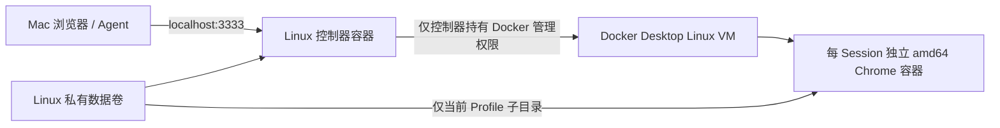

# M 系列 Mac 部署适配

更新日期：2026-10-13，北京时间。目标机器：Apple Silicon Mac，32 GiB 内存。容器控制器的完整部署链路已在 Linux amd64 通过自动验收，Apple Silicon 实机验收仍未完成。

## 目标结构

Mac 上安装 Docker Desktop，网页访问本机回环入口。控制服务、文件锁、SQLite 与浏览器运行环境都使用 Linux；网页仍然展示容器内 Chrome，保留两个固定扩展和人机交接。



控制器采用构建机器的原生架构，M 系列目标为 arm64；现有官方 Chrome 包和浏览器镜像保持 linux/amd64。Docker Desktop 支持架构模拟，但不能据此认定 Chrome 的 namespace/seccomp 沙箱和 zkPass 已兼容。实际 Mac 上必须保留沙箱完成验收；失败时记录原因，不自动添加 `--no-sandbox` 或放宽容器权限。

先给 Docker Desktop 约 12 GiB 内存、4 个 CPU，实例并发限制为 1，作为这台 32 GiB Mac 的试验起点。这是初始配置建议，尚未进行 M 系列性能测量。控制器限制为 1 GiB、1 CPU；浏览器现有限制为 2 GiB、2 CPU，另有构建和 Linux VM 开销。确认单会话稳定后再评估并发。

Docker VMM 当前对 Rosetta 有限制；初次验收可选择支持 Rosetta 设置的 Apple Virtualization framework，具体设置以本机 Docker Desktop 版本为准。[Docker 多平台说明](https://docs.docker.com/build/building/multi-platform/)、[Mac VMM 说明](https://docs.docker.com/desktop/features/vmm/)、[资源设置](https://docs.docker.com/desktop/settings-and-maintenance/settings/)。

## 已准备的代码

- `runtime/controller.Dockerfile`：固定来源的 Docker CLI、Node 24、Python 与 Linux 锁工具；服务以 node 用户运行。镜像不包含宿主机 Docker socket、真实用户数据或部署凭据。
- `scripts/build-container-images.sh`：在容器内校验/下载固定 Chrome 和 CRX 包，再构建 amd64 浏览器镜像。Mac 不需另外安装 Node、Python、dpkg-deb 或 flock 来构建。
- `BROWSER_DATA_VOLUME` 和 `BROWSER_DATA_VOLUME_ROOT`：控制器使用 Docker 数据卷，浏览器和代理只挂载所需子目录；禁止挂载卷根、越界路径和符号链接逃逸。
- Runtime 显式指定 `--platform linux/amd64`，启动时核对镜像架构；原 Linux 宿主机的 bind mount 路径继续支持。
- `compose.yaml` 和 `scripts/compose.sh`：仅控制器挂载 Docker socket；自动读取 socket 在 Linux 容器内的组编号。非 root 服务使用附加组访问 socket，不使用 privileged，也不把该组传给 Chrome/代理。

Docker 的 volume-subpath 从 Engine 26 引入，启动时检查服务端支持，卷与子目录必须预先存在。[子目录挂载说明](https://docs.docker.com/engine/storage/volumes/#mount-a-volume-subdirectory)、[Engine 26 说明](https://docs.docker.com/engine/release-notes/26.0/)。

Mac 原型还要求 Docker API 1.49 或更新版本（Engine 28+），用于在 arm64 控制器内明确检查 amd64 镜像，避免多平台镜像被按宿主架构错误解析。[镜像平台检查](https://docs.docker.com/reference/cli/docker/image/inspect/)。

仅构建镜像的命令如下；它不启动控制服务，也不授予任何容器 Docker 管理权限：

```sh
bash scripts/build-container-images.sh
```

包缓存位于忽略提交的 `output/runtime/packages`。上游安装包发生变化时校验失败，不能自动忽略摘要；可复制自己保存的无账号数据安装包缓存，或审核新版本并重新验收。

## 已授权的控制器权限

用户在了解范围后明确授权：“授权仅控制器容器挂载 Docker socket”。此前因授权不够明确被自动审批阻止的配置现已落地，并在独立测试项目中执行。没有切换现有宿主机服务，也没有访问用户 Mac。

Docker socket 赋予控制器管理该 Docker 引擎全部容器和卷的能力，不是只限本项目。Mac 上主要作用于 Docker Desktop 的 Linux VM 及 Docker 可访问的共享文件，不等于直接取得 macOS 管理员权限。代码按实例标签清理，不改变 socket 本身的权限范围。见 [Docker 安全说明](https://docs.docker.com/engine/security/) 和 [Mac 权限说明](https://docs.docker.com/desktop/setup/install/mac-permission-requirements/)。

| 项目 | 已落地设置 |
| --- | --- |
| 获得权限的组件 | 仅 `agentic-browser:controller-preview` 控制器容器。 |
| Docker 管理连接 | 控制器读写 Docker Unix socket，容器内路径 `/var/run/docker.sock`；权限并不局限于本项目容器。 |
| 服务进程 | 非 root 的 node 用户，使用 socket 所需的附加组；不使用 privileged。 |
| 网页入口 | 仅发布 `127.0.0.1:3333`，不直接公开到局域网或公网。 |
| 数据 | 专属 named volume；控制器管理完整数据卷，Chrome 仅挂载获授权的一个 Profile 子目录，代理仅挂载自己的 socket 目录。 |
| 浏览器容器 | 不挂载 Docker socket，不挂载完整数据卷；继续 network none、只读根、cap-drop ALL 和 Chrome 沙箱。 |
| 停止 | 正常结束会话并等待 Runtime 回收，保留主动保存的数据卷；不全局清理 Docker。 |

## Mac 本机启动

先安装并启动 Docker Desktop，选择本机 Docker context。需 Engine 28+、Compose v2+；不支持用 SSH/TCP 远端 context 代替本机引擎。以下命令在项目根目录运行，构建与启动不需要 Mac 另装 Node/Python；若使用本机 stdio MCP，客户端依赖另见 [Agent 接入](AGENT_CLIENT.md)。

```sh
bash scripts/build-container-images.sh
bash scripts/compose.sh up -d --wait --wait-timeout 120
bash scripts/compose.sh exec controller node --import tsx src/doctor.ts
bash scripts/compose.sh exec controller node --import tsx src/members-cli.ts create alice
```

最后一步在本机终端交互设置 Agentic Browser 成员密码，至少 12 字符，输入不显示。它不是 Google/GitHub 密码，不需要发给 Agent。默认没有通用账号和预置密码。

浏览器打开 `http://127.0.0.1:3333`，用该成员登录工作台。之后在工作台创建个人 Agent 凭据。Chrome 和两项扩展仍运行在 Linux 浏览器容器里，通过网页镜像接管。

若本机 3333 已被占用，复制 `.env.compose.example` 到 `.env.compose`，将 `AB_PORT` 改为一个空闲端口，例如 3334，再执行启动命令。默认 `PUBLIC_URL` 会跟随端口；若设置 `AB_PUBLIC_URL`，必须和实际访问入口一致。脚本不读取原宿主机服务的 `.env`，也不会把里面的共享 token 带入新部署。

`AB_PROJECT_NAME` 同时确定 Compose 项目和私有数据卷，默认数据卷为 `agentic-browser-data`。开始使用后不要随意更名，否则会选择另一份空数据。只有明确部署另一套实例时才使用新名字和端口。

脚本在 Mac 上挂载 Docker Desktop VM 提供的 `/var/run/docker.sock`，并用一个短暂的控制器容器读取其 Linux 组编号；不依赖 macOS 上的同路径符号链接，也不修改 socket 权限。Linux 使用当前本机 context 的 Unix socket。两种情况都只有控制器镜像拿到 socket。

## 停止、重启和排查

```sh
bash scripts/compose.sh ps
bash scripts/compose.sh logs --tail 100 controller
bash scripts/compose.sh stop
bash scripts/compose.sh up -d --wait --wait-timeout 120
```

正常停止最多给控制器 60 秒回收活动浏览器和代理，主动保存的 Profile 与成员数据留在数据卷。升级镜像后用 `up -d --force-recreate --wait --wait-timeout 120` 重建控制器；活动 Session 不跨控制器重启恢复。异常退出后的首次启动根据本实例账本回收残留容器，之后可以重新打开保存的 Profile。

`down` 移除本套 Compose 容器/网络但保留卷；`down --volumes` 会删除成员和保存的登录数据，不用于日常停止。不要用全局 Docker prune 清理项目。

若 socket 访问失败，先确认 Docker Desktop 已运行及本机 context 正确。若 Chrome 在 Apple Silicon 模拟下启动失败，保留错误信息核对，不自动关闭 Chrome 沙箱或启用 privileged。

## 验收边界

`npm run test:controller` 已在当前 Linux amd64 主机通过：真实 Compose 控制器以 uid 1000 运行，只有控制器挂载 socket；浏览器/代理只挂载卷内所需子目录；跨成员访问被拒绝；人工镜像刷新、原生虚构登录、交还和 Agent 读取成功；Chrome namespace/seccomp 沙箱启用；控制器重建后虚构 Cookie 保留；SIGKILL 后恢复和正常停止均清理所属浏览器/代理。测试使用单独的随机命名卷，结束后全部删除，不操作真实登录配置。它也已加入 `npm run verify`，执行前需构建控制器镜像。

Apple Silicon 的实际构建/运行、Chrome 沙箱、两个扩展、镜像输入、保存配置再开及性能，仍需在用户 Mac 上验收。初次验收先使用内置虚构登录页完成同样流程，再选择是否保存真实登录状态。

最后以 [进度记录](PROGRESS.md) 中的实际执行结果为准；不将 amd64 Linux 的成功结果标注为 Mac 或 ARM 成功。
