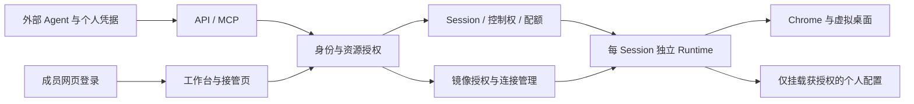

# Agentic Browser 总体计划

更新日期：2026-10-14，北京时间。状态：公共演示、自部署真实使用及团队数据隔离方向已确认；现增加供访客外部 Agent 使用的公网 HTTP MCP 演示。

我们要做一个可以由 Agent 和人共同操作的远程浏览器：Agent 执行网页任务，遇到登录或人工确认时暂停；人在镜像页面完成操作后，交还同一个浏览器，Agent 接着完成任务。浏览器继续运行在 Ubuntu 上。

真实使用由个人或团队自行部署，公共部署只用于演示协作功能。同一个自部署实例可以服务多个团队成员，但成员默认不共享会话、登录配置和镜像画面。下一阶段仍以外部 Agent 工具为主线，将成员身份、资源归属和运行环境隔离作为团队使用的前置条件。

实现状态见 [进度记录](PROGRESS.md)，详细规则见 [会话与镜像管理设计](SESSION_AND_MIRROR_DESIGN.md)，安装和当前接口见 [README](../README.md)。S1/S2/S3 基础实现和自动验收已完成；具体上线范围以进度记录为准。

## 已确定的方向

| 方向 | 约定 |
| --- | --- |
| 浏览器位置 | 运行在远程 Ubuntu，用户在 Mac 等设备通过镜像操作。 |
| 人机协作 | 人和 Agent 使用同一个浏览器会话；人工接管时停止本服务的 Agent 操作和观察接口。 |
| 登录方式 | 用户在浏览器内完成密码、验证码等输入，交还后 Agent 继续。 |
| 会话稳定性 | 默认临时会话；主动选择后保存登录配置；支持断线重连、到期提醒和续期。 |
| 任务入口 | 优先供外部 Agent 通过 API/MCP 调用，内置 Agent 后置。 |
| 真实使用 | 向外部个人或团队交付自部署版本，真实数据由部署者管理。 |
| 团队隔离 | 同一实例支持多位成员，分别管理身份、Agent 凭据、会话、登录配置及镜像权限。 |
| 公共部署 | 只演示功能；真实使用引导至自部署，不建设承载真实业务的通用托管服务。 |
| 基础依赖 | 保持精简；新增依赖应服务于明确需求，不引入支付、x402 或不必要的云平台依赖。 |
| 固定浏览器扩展 | 支持 zkPass TransGate 与 zkPass Schema Validator；管理员发布环境版本，成员各自保存扩展数据。安装与制作方式见专项设计。 |
| 来源说明 | 继续维护第三方和来源说明，按自身需求组织实现与产品体验。 |

## 第一版应该完成的使用流程

1. 部署者启动实例，建立成员身份；单人部署沿用同一资源归属模型。
2. 成员为外部 Agent 签发个人凭据，选择允许使用的能力和保存配置。
3. Agent 创建临时 Session，或使用明确获授权的保存配置。同一任务的后续操作复用该 Session。
4. 需要登录、验证码或人工判断时，Agent 交出控制权，并给出需要用户登录的接管入口。
5. 用户验证身份后接管自己的浏览器。完成后交还，Agent 获知交接结果并继续。
6. 任务结束后，调用方按约定关闭 Session；未主动关闭的会话受期限和资源策略约束。清理临时环境与删除保存配置分别处理。
7. 网络断开时，页面说明连接和控制权状态。重连重新鉴权；过期或服务中断不会自动重放任务。
8. 下次任务可复用本人主动保存、且对该 Agent 授权的配置。其他成员无法列出、复用或删除这些数据。

任务目标和结果先由外部 Agent 管理，网页承担会话管理与人工接管。当前网页中的“任务名称”只是会话备注，不是自动执行任务的指令。

公共演示采用短期访客身份和独立临时会话。原 `demo` 模式强制断网并执行固定虚构流程；新 `public` 模式让访客自己的 Agent 通过远程 MCP 访问公网网页，保留私网/元数据拦截，禁止保存配置，限制并发和期限。真实业务数据继续推荐自部署团队模式。

## 当前基础与目标架构

当前已有 HTTP/MCP、会话控制、Chrome 虚拟桌面、noVNC 镜像、保存配置和网页工作台。Agent 阶段通过浏览器自动化连接操作网页；人工阶段断开本服务的自动化连接，使用 noVNC 操作完整远程窗口。交还时撤销镜像连接，再接回同一个 Chrome。

当前主要模块：

| 模块 | 当前职责 |
| --- | --- |
| [sessions.ts](../src/sessions.ts) | 会话期限、控制权切换、操作排队和旧操作失效。 |
| [desktop.ts](../src/desktop.ts) | 启动和关闭远程 Chrome、虚拟显示器及原生输入服务。 |
| [desktop-gateway.ts](../src/desktop-gateway.ts) | 已认证的 WebSocket 镜像连接。 |
| [profiles.ts](../src/profiles.ts) | 保存配置、跨进程互斥、删除及目录权限。 |
| [browser.ts](../src/browser.ts) | 网页导航、快照、点击、输入和标签页操作。 |
| [http.ts](../src/http.ts) 与 [mcp.ts](../src/mcp.ts) | 浏览器能力的 HTTP 与 MCP 接口。 |
| [web](../web) | 创建会话、选择登录配置、人工接管、重连和续期。 |

当前架构如下；成员身份、每资源授权、隔离 Runtime 和一次性镜像授权已实现并通过自动验收。

需要分开的概念：

| 概念 | 含义与设计边界 |
| --- | --- |
| User / AgentCredential | 成员身份与代表该成员调用的 Agent 凭据；不能继续共用一个实例令牌。 |
| Session | 一次连续浏览器任务的运行单元；不是每次点击或工具调用都创建新环境。 |
| Control | 当前由 Agent 还是人工控制，以及交接版本；与网络连接状态分别管理。 |
| Runtime | Session 使用的隔离运行环境；正常结束和异常残留都需要可核对地回收。 |
| Profile | 用户主动保留的浏览器数据，独立于临时运行环境；同一时间只允许一个浏览器写入。 |
| MirrorGrant | 人工身份取得的一次性连接授权；同一会话只允许一个可输入窗口。 |
| Event | 必要的生命周期、交接和错误记录；不存密码、Cookie、完整页面或输入正文。 |

远程画面镜像与基础运行镜像分别管理：前者属于用户会话并鉴权；后者包含 Chrome、依赖及批准的扩展软件或安装策略，可复用只读层，不包含任何用户数据。详细状态、授权矩阵和迁移规则见 [专项设计](SESSION_AND_MIRROR_DESIGN.md)。

## 分阶段路线

根据最新部署定位调整阶段编号：原计划 M2 的完整 Agent 接入移至 M3；原托管注册路线由公共演示替代。以下是建议实施顺序，不是已完成状态或交付日期承诺。

| 阶段 | 目标 | 交付与验收 | 当前状态 |
| --- | --- | --- | --- |
| M0 人机协作基础 | Agent 和人操作同一个远程浏览器 | 创建、操作、接管、交还、继续；真实 Google 登录后进入 Gmail 读取页面。 | 已完成基础验收 |
| M1 会话稳定性 | 保存配置、重连与期限可预期 | 补做真实账号重复打开及正常服务重启后的复用验收。 | 功能与自动化验证已完成，真实配置复用待验收 |
| M2 团队会话与镜像隔离 | 同一实例内成员数据互不可见 | 成员与 Agent 凭据、资源归属、隔离 Runtime、异常回收、人工镜像独占和撤销。 | S1/S2/S3 已实现并自动验收 |
| M3 外部 Agent 完整接入 | 任务能顺畅跨过人工步骤 | 真实客户端接入、等待、超时、取消、交还通知和有效接管入口。 | HTTP/MCP 及 SDK 链路已验收；2026-10-14 用户确认 Claude CLI 公共体验成功，其他客户端继续验收 |
| M4 自部署发行与公共演示 | 团队能自行安装，访客能体验协作 | 自部署从干净主机完成两成员流程；公共演示验证临时身份、隔离、限额及清理。 | Codex/Claude CLI 用户实测通过；GHCR 双架构公开镜像、匿名下载及干净目录部署通过，新主机和新镜像 Mac 实机验收待补充 |
| M5 发布与持续维护 | 升级、数据管理和故障处理可复现 | 版本与基础镜像管理、兼容验证、配置备份恢复、诊断及清理文档。 | GitHub Actions 与 digest 固定发行已完成；实际升级、Profile 兼容与备份回退继续推进 |

### M1 剩余验收

自动化已验证虚构 Cookie 在完整服务进程重启后保留。真实账号需由用户在远程 Chrome 主动创建保存配置并登录，交还 Agent 完成只读任务；随后结束会话，以同一配置创建新会话，再安排一次正常服务重启，分别检查网站登录状态。

同时检查断网恢复保持原控制权，以及过期关闭会话而保留配置。真实网站可能要求再次验证，应记录实际表现；密码、Cookie 和带令牌的链接不进入聊天、测试代码或进度文档。

### M2 团队会话与镜像隔离

按 [专项设计的实现批次](SESSION_AND_MIRROR_DESIGN.md#实现批次与验收) 推进 S1 至 S3：

1. **身份与归属**：成员、个人 Agent 凭据、Session/Profile 所有者和逐接口授权。已有无所有者配置先冻结，由部署者确认归属后迁移。
2. **运行环境与回收**：为每个 Session 分配独立文件空间、进程与网络边界，只挂载授权配置；新增资源记账、残留清点及失败清理。首版使用 Linux Docker 容器。
3. **镜像权限**：人工身份签发短期一次性连接授权，Agent 不能取得人工操作秘密。同一时刻一个窗口输入，交还、过期、停用和撤销立即作用于已连接镜像。

验收必须包含两个成员及各自 Agent，覆盖按 ID 越权、直接接口访问、配置复用、画面读取、存活连接撤销和异常退出。只有正常流程测试通过，不足以认定团队隔离完成。

### M3 外部 Agent 完整接入

现有 MCP 有 11 个工具；以下核心协议已实现并自动验收，客户端人工配置体验继续核对：

- 在实际客户端配置个人凭据，完成创建、接管、交还和结果读取。
- 提供可超时、可取消的状态等待机制；已采用最长 25 秒长轮询，并支持 MCP 取消。
- 返回不含人工操作秘密的接管入口，说明用户登录、端口不通、会话结束及浏览器故障的区别。
- 区分取消等待、停止任务和关闭浏览器；超时、过期、恢复后不自动重放网页提交。
- 适配新的权限与资源模型，保留必要的工具兼容说明和可复现示例。

外部 Agent 继续管理任务目标和结果，不因此增加内置模型执行器或完整持久任务系统。

### M4 自部署发行与公共演示

两者复用核心、资源归属和镜像协议，以部署策略区分能力。

| 交付 | 第一版内容 | 验收条件 |
| --- | --- | --- |
| 自部署 | 可复现安装、成员管理、个人 Agent 凭据、私有配置、配额、HTTPS/代理指引、升级和卸载说明。 | 干净主机按文档启动；两名成员各自登录、接管、交还，互不可见；保存配置与清理行为符合说明。 |
| 公共演示 | 短期访客、独立临时环境、远程 `/mcp`、外部 Agent 与人工协作、公网网页、资源限制及回收；原断网演示另保留。 | URL 配置接入；会话密钥隔离；禁止保存配置和访问私网/元数据；并发、时长、频率限制；回收和重启失效。 |

公共演示不使用真实业务的配置目录或管理凭据。自部署无需连接公共服务才能启动。首版控制服务运行于 Linux 主机，Chrome 使用 Docker，不能用“自己部署”代替对团队成员的隔离验证。

固定扩展采用 [扩展与运行镜像设计](EXTENSIONS_AND_IMAGES_DESIGN.md) 中的 E0 至 E3 批次：先在独立环境验证两个扩展及 CDP 交接，再接入 Runtime 模板、启动就绪和发布流程。镜像安装策略与个人扩展数据分别管理。

### M5 发布与持续维护

建立可追溯的源码与基础镜像版本，升级默认只影响新会话。涉及 Chrome 配置格式变化时验证兼容和恢复；运行中的会话按明确的维护策略结束，不在人工操作中静默替换浏览器。

文档覆盖私有数据位置、备份访问权限、恢复、用户停用、保留期限和卸载后的数据处理。运维界面默认展示资源用量与健康状态，管理能力不自动授予查看成员页面或复用其登录配置的权限。

## 近期工作顺序

用户已反馈 M 系列 Mac、32 GiB 的本地部署测试通过，并要求下一步部署 Ubuntu 公共 MCP 演示；仅控制器挂载 Docker socket 的授权继续适用。此前 Mac 沙箱失败证据保留，本轮不把用户的功能测试反馈等同于重新取得 Seccomp-BPF 证据。详见 [Mac 部署指南](MAC_DEPLOYMENT.md) 与 [进度](PROGRESS.md)。

S1/S2/S3、MCP 完整协作和受限双访客演示已自动验收。Ubuntu 公共 MCP 已部署到 `https://agentic-browser.zkpass.org`，域名入口、镜像 WebSocket 和人工交接已验证；2026-10-14 用户确认 Codex 和 Claude CLI 实测成功。按用户要求暂缓 Cloudflare 到源站的 TLS 配置。当前优先完成：

1. 全站容量按用户要求配置为 5，保留每来源 IP 2 个；主页与 MCP 展示占用量及满额重试提示，启动和清理中的名额继续计数。五浏览器限额、关闭释放、断线重连与异常清理已验收；继续补充运行耗时/失败统计和更长时间负载观察，再开展小范围体验。
2. GitHub Actions 原生 amd64/arm64 验收、GHCR 公开发行、digest 固定部署包与匿名拉取已完成，版本为 `v0.1.0-preview.1`。下一步在 M 系列 Mac 用新原生 ARM 镜像实机复验，并补充另一台干净主机的安装验收；Codex 和 Claude CLI 已由用户确认通过，Cursor 另行记录。
3. 用户回来后验收真实保存配置复用，并提供 zkPass 应用/Schema 及测试数据源，完成真实证明与失败/取消路径。
4. 根据真实使用结果确定正式发布渠道，验证实际版本升级、Profile 兼容、备份恢复及镜像回退。

已经通过的自动化与待人工验收分别见 [进度记录](PROGRESS.md)。不使用真实账号秘密代替虚构测试夹具，不将本地预览包称为已发布服务。

## 决策记录与待讨论事项

| 编号 | 决定 | 当前选择或候选 | 状态与影响 |
| --- | --- | --- | --- |
| D1 | 任务入口 | 外部 Agent 工具优先。 | 用户已确认；内置 Agent 后置。 |
| D2 | 使用对象 | 向外部个人和团队交付自部署版本。 | 用户已确认；团队共用实例须隔离数据。 |
| D3 | 公共部署定位 | 只演示功能，真实使用由用户自行部署。 | 用户最新澄清；替代此前对通用托管注册服务的理解。 |
| D4 | 首批客户端与任务 | 用户自己的 Agent，提供 Codex 和 Claude Code 接入方式；HTTPS 首页以 GitHub 登录后读取私有仓库为体验任务。 | 公网入口与 SDK 链路已验证；2026-10-14 用户确认 Codex 和 Claude CLI 成功，Cursor 实际体验待补充。 |
| D5 | 任务结束后的 Session | 调用方主动关闭；公共模式初始 5 分钟、最长 10 分钟。 | 已实现；公网演示不保存登录配置。 |
| D6 | 信息留存 | 只保留必要状态、交接与错误类别。 | 设计建议；事件和停用用户配置的保留期限待确定。 |
| D7 | 自部署发布方式 | GHCR 公共双架构镜像和 digest 固定部署包，保留源码构建。 | 用户已确认；首个预览版已发布并通过匿名拉取。私有仓库中的部署包由管理员分发，保留来源说明。 |
| D8 | 实施顺序 | 身份归属 → Runtime 隔离 → 镜像权限 → 完整 Agent 接入 → 发行与演示。 | S1/S2/S3、M3 及受限演示已实现，发行验收继续推进。 |
| D9 | 团队身份与资源策略 | 管理员本地创建成员；SQLite、scrypt、个人凭据；默认每成员 2 个会话。 | 已实现；SSO 可后续接入。 |
| D10 | 公共演示范围 | 用户确认允许公网网页，需要限额；先 IP，再可替换域名。 | 新增 public 模式及 HTTP MCP；保留私网/元数据拦截、禁止保存配置，原断网 demo 独立保留。 |
| D11 | 团队资源共享 | 默认成员私有；首版不做共享配置或多人旁观。 | 私有隔离为已确认要求，具体扩展范围为设计建议。 |
| D12 | 固定扩展与环境版本 | zkPass TransGate、zkPass Schema Validator；支持创建环境时采用自定义镜像。 | 扩展名称已确认；用户进一步提出预装后制作镜像，设计优先内置原始包与本地初始化，断网安装和 Validator 合成业务已通过，真实 TransGate 证明仍待验收。 |

## 当前边界

团队模式已经实现成员身份、逐凭据会话绑定、明确的 Profile 授权和独立人工镜像鉴权；legacy 模式保留共享令牌以兼容可信单用户。Docker 后端已加入每 Session 的 OS/网络边界并完成异常回收测试；仍需正式发行环境核对、网络策略审查和真实业务验收。

会话回收和数据隔离是两项能力：前者管理结束后的资源，后者限制运行期间的访问。主动保存配置不会随会话回收被删除。宿主机管理员仍在信任边界内，交给外部 Agent 的页面内容也不会因回收浏览器而从 Agent 记录中撤回。

正常重启后的恢复是用保存配置创建新会话，不包含原控制权或未完成任务的自动恢复。内置 Agent、持久任务历史、共享配置、多人旁观、定时任务等按后续反馈再排期。

## 文档维护

目标、范围或关键决定变化时更新本文件。每批开发或验收更新 [进度记录](PROGRESS.md) 的状态、证据及下一步。

“已实现”“自动化已验证”“真实使用验收通过”分别记录。运行健康与端口映射只代表检查当时的状态。权限和生命周期变更同步维护 [专项设计](SESSION_AND_MIRROR_DESIGN.md)。
