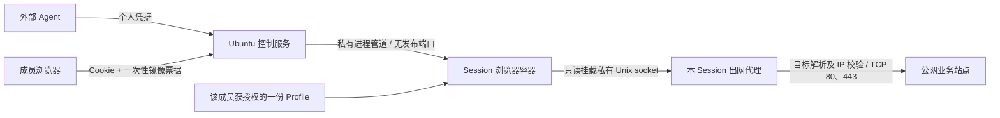

# 独立浏览器 Runtime

每次创建 Session 分配一个受限 Docker 浏览器容器；同一任务后续调用复用它。团队模式启动时强制要求 `BROWSER_MODE=docker`。控制服务运行在 Ubuntu 上并管理 Docker，浏览器容器不挂载 Docker socket、控制服务数据目录或其他成员配置。



浏览器容器使用 `--network none`、非 root 用户、只读根目录、独立 tmpfs 和共享内存、cap-drop ALL、no-new-privileges，以及经过验收的 Chrome 沙箱 seccomp 配置。每份浏览器限制 2 CPU、2 GiB 内存、512 进程；CDP、VNC、显示器和临时 HOME 留在容器内。控制服务与浏览器 worker 只通过 Docker stdin/stdout 交换操作和画面，不发布调试端口。

临时模式没有历史配置挂载；保存模式仅挂载授权 Profile 的 Chrome 子目录。扩展包在镜像只读层中，扩展个人数据写入当前 Profile。Chrome 子进程只接收显式允许的环境变量，不继承部署令牌、数据库秘密或宿主机 HOME。

## 启动

要求 Linux、Node 24、Python 3、Docker 和可访问 Docker 的非 root 服务用户。当前镜像仅验证 linux/amd64。先构建并验收镜像，再建立成员：

```sh
npm ci
npm run runtime:build
npm run test:extensions
npm run members -- create alice
```

在私有 `.env` 中设置：

```dotenv
BROWSER_AUTH_MODE=team
BROWSER_MODE=docker
BROWSER_RUNTIME_IMAGE=agentic-browser:zkpass-prototype
BROWSER_NETWORK=public
BROWSER_DATA_DIR=.data
PUBLIC_URL=http://127.0.0.1:3333
HOST=127.0.0.1
PORT=3333
MAX_SESSIONS=4
MAX_SESSIONS_PER_MEMBER=2
SESSION_TTL_SECONDS=1800
SESSION_MAX_LIFETIME_SECONDS=14400
```

然后 `npm start`，通过 SSH/编辑器端口转发访问工作台。公共 HTTPS 入口配置为实际 `PUBLIC_URL`；使用反向代理时需要保留 WebSocket 和 Origin。团队模式不接受共享服务令牌。[成员与 Agent 配置](TEAM_SETUP.md) 单独说明。

首版只从部署者选择的本地镜像启动；初始化把标签解析为不可变镜像 ID，当前控制进程创建的环境使用相同版本。Session API 不允许用户传入 Docker 参数、宿主机路径或任意镜像。启动检查两项固定扩展的 ID、版本与启用状态，不匹配时拒绝交付该会话。

## 出网边界

`BROWSER_NETWORK=none` 完全不提供出网代理。`public` 为每个 Session 增加一个小型代理容器，代理仅监听该 Session 的 Unix socket，不发布宿主机端口，也不挂载 Profile。浏览器的网络命名空间仍为 none，无法通过修改代理设置、WebRTC/UDP 或其他直连绕过。

代理仅允许公网 TCP 80/443，支持 HTTP、HTTPS CONNECT 和 WebSocket；解析全部 DNS 结果，发现私有或特殊地址则拒绝，连接时使用已经检查的具体 IP，避免二次解析绕过。管理入口主机名及其 IP 别名也被阻断；可用 `BROWSER_EGRESS_DENY_HOSTS=其他管理域名,管理公网IP` 补充。管理域名解析失败时拒绝请求。私网、回环、链路本地、云元数据、共享地址、文档及其他保留段默认不可访问；内网业务和非 80/443 协议目前不支持。

内置协作演示位于每个容器自身的固定回环端口 8080，只提供三项静态资源，不含控制 API。工具可导航到 `https://agentic-browser.invalid/demo`，worker 将它映射到当前容器的演示站。浏览器代理仅为这一固定回环端口设置例外，其余回环目标仍经代理拒绝。该地址是产品内部约定，不进行公网 DNS 请求。

策略参考 [IANA IPv4 特殊地址登记](https://www.iana.org/assignments/iana-ipv4-special-registry/)、[IPv6 登记](https://www.iana.org/assignments/iana-ipv6-special-registry/) 及 [Chromium 代理规则](https://chromium.googlesource.com/chromium/src/+/HEAD/net/docs/proxy.md)。这些规则不是企业防火墙的替代品；部署者还需把自身管理公网域名/IP 纳入禁止目标。zkPass 的真实业务节点和非标准端口尚未验收。

## 回收和恢复

控制器持有数据目录的排他 flock；同一目录不能同时运行两个控制器。`.data/runtimes/` 保存实例标识和每个 Runtime 的资源记录。Docker 资源带实例与 Runtime 标签；清理前匹配标签，不按任意 PID 杀进程，不清理其他项目的容器。

正常关闭先让 Chrome 退出并保存，再确认容器停止、清理临时代理目录，最后释放 Profile 占用。清理失败保持 `cleanup_pending` 和记录，由周期任务重试；不能将其报告为已清理。实例并发和每成员并发都包含正在启动的资源，续期不能超过绝对寿命上限。

控制进程异常退出会关闭 worker 输入管道；重启还会用持久记录核对并关闭残留容器。只有确认对应容器消失后，才能清理该容器 hostname 对应的 Chrome 单例锁。其他 namespace 或宿主机 Chrome 的锁不会被清除。恢复保存配置会创建新 Session，不恢复旧控制权或自动重放网页提交。

## 已有验收及未完成项

`npm run test:runtime` 覆盖两个容器的文件/环境/挂载/网络隔离、扩展启动就绪、交还、保存配置再开、公网代理、私网阻断、容器强制终止，以及控制进程 SIGKILL 后的清点。公网测试使用无凭据的合成 HTTP 请求，依赖外部测试服务可用。

`AGENTIC_TEST_DOCKER=1 npx tsx --test test/team-desktop.integration.ts` 覆盖真实成员 Cookie、一次性票据、单窗口 noVNC、断网恢复、虚构登录和交还的完整容器链路。所有测试使用临时数据和项目专属容器标签。

仍需完成正式发行验收、生产网络策略审查、模板升级/回退管理，以及真实账号保存复用和 TransGate 证明。容器隔离不能保证不存在内核/浏览器漏洞，宿主机管理员仍在信任边界内；会话回收也不会删除用户已主动保存的 Profile 或外部 Agent 已取得的信息。
