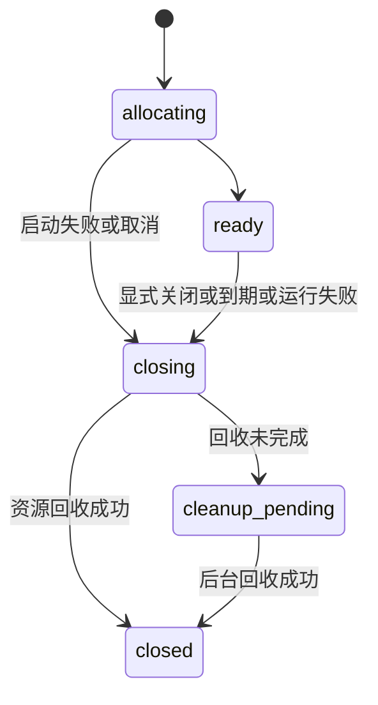

# Agentic Browser 会话与镜像管理设计

更新日期：2026-10-13，北京时间。状态：S1/S2/S3、MCP 等待交接与受限访客演示均已实现并自动验收。详见 [进度记录](PROGRESS.md) 和 [成员原型使用说明](TEAM_SETUP.md)。

真实使用以个人或团队自行部署为主，公共部署只演示 Agent 操作、人工接管和交还。自部署实例中的团队成员共享计算资源，但默认不共享浏览器会话、登录配置或镜像画面。

本设计把 Session 定义为一次连续浏览器任务的运行单元。创建 Session 时分配独立浏览器环境，后续 Agent 调用复用它；结束或到期后回收。主动保存的登录配置独立于临时运行环境，按用户归属保留。

这里分别设计远程画面镜像，以及可用于部署的基础运行镜像。前者是用户看到并操作的浏览器窗口，后者只包含浏览器、运行依赖及批准的扩展软件或安装策略，两者都不能成为跨用户复用登录数据的途径。

总体路线见 [总体计划](PLAN.md)，实现状态见 [进度记录](PROGRESS.md)。本文保留整体设计，当前已实现范围以进度记录和使用指南为准；持久事件历史、管理员网页、跨版本模板管理等仍属后续能力。

## 部署模式

| 项目 | 公共演示模式 | 自部署模式 |
| --- | --- | --- |
| 使用目的 | 体验协作功能。 | 处理个人或团队的真实任务。 |
| 身份 | 为每位访客分配短期独立身份；不能共用一条接管链接。 | 每位成员独立身份；单人部署也使用同一归属模型。 |
| 会话 | 仅临时会话，限制期限、并发和资源用量。 | 默认临时，期限和配额由实例管理员配置。 |
| 登录数据 | 建议首版仅使用内置演示站及虚构账号。 | 用户可以登录自己的业务网站。 |
| 保存配置 | 服务端禁用保存和复用配置。 | 用户主动选择后保存，默认仅本人及获授权 Agent 可复用。 |
| 网络 | 建议首版仅允许演示站需要的目标，禁止任意浏览器出网。 | 根据团队业务配置允许的网络；始终隔离宿主机管理面和其他会话。 |
| 产品能力 | 演示脚本、接管入口、清理倒计时及自部署指引。 | 成员、个人凭据、私有会话与配置、接管、配额及运维。 |

公共演示首版建议不建设通用注册和长期账户存储。访客身份与演示 Agent 的能力都只绑定自己的会话，不把服务管理凭据交给网页。演示实例与真实业务实例分开部署，不挂载开发环境或真实用户的配置目录。

演示目标限制必须在浏览器运行环境的网络侧落实，覆盖地址栏、重定向、子资源和 WebSocket；仅限制 Agent 的导航 API 不够。首版已选择强制断网、仅容器内虚构站点；访问真实外部网站属于自部署使用。

## 身份与资源模型

第一版按“一个自部署实例服务一个团队”设计，不增加多组织 SaaS 结构。建议由实例管理员创建或邀请成员；以后接企业身份系统时复用相同的资源归属规则。

| 对象 | 关键字段或关系 | 规则 |
| --- | --- | --- |
| User | `id`、成员状态、实例角色 | 真实使用者，拥有自己的会话和配置。 |
| AgentCredential | `id`、`ownerUserId`、权限范围、撤销状态 | Agent 代表某个成员操作，不作为第二个独立人类用户；成员可为不同 Agent 创建不同凭据。 |
| Session | `id`、`ownerUserId`、`agentCredentialId?`、`profileId?`、`runtimeId`、期限 | 用户归属不可由请求正文随意指定；Agent 操作默认绑定创建该会话的凭据。 |
| Profile | `id`、`ownerUserId`、名称、独占占用状态 | 保存的浏览器数据；名称与路径不用于判断权限。 |
| Runtime | `id`、`sessionId`、运行镜像版本、健康状态、资源标识 | 一份隔离的 Chrome、显示器、文件空间与内部连接端点。 |
| MirrorGrant | 会话、用户、运行环境、控制权版本、镜像版本、有效期 | 经过用户身份验证后签发的短期镜像授权，用于建立一次连接。 |
| Event | 会话、主体、事件类别、时间、错误类别 | 记录生命周期与交接结果，不存输入正文、Cookie、完整网址或页面内容。 |

用户与资源元数据需要持久化。浏览器配置存放在私有数据目录或卷中，不混入普通事件记录；当前使用本地 SQLite 保存身份与凭据，私有文件保存 Profile 元数据及 Runtime 账本。

成员直接从工作台创建的会话可以暂不绑定 Agent，初始进入人工控制；需要 Agent 继续时由所有者明确绑定自己的某个凭据。Agent 不能凭已知会话 ID 自动认领；更换绑定需先停止旧动作并使旧授权失效。

### 第一版权限

| 操作 | 资源所有者的网页登录身份 | 当前绑定的 Agent 凭据 | 其他团队成员 | 实例管理员 |
| --- | --- | --- | --- | --- |
| 查看私有会话、配置元数据 | 允许本人资源。 | 会话仅限所绑定资源；配置需明确授予列表权限。 | 拒绝。 | 默认只看资源用量和运维状态，不展示页面标题、网址或内容。 |
| 创建会话、复用保存配置 | 允许本人资源。 | 按凭据权限创建；配置复用限制到授权的配置。 | 不能使用他人资源。 | 使用自己的用户身份创建，不能以管理权限默认复用他人配置。 |
| 浏览器动作、快照、截图 | 按控制权使用人工入口。 | 仅 Agent 控制阶段和绑定会话。 | 拒绝。 | 无默认观察能力。 |
| 发起人工接管 | 允许本人会话。 | 可以提出交接并暂停自己。 | 拒绝。 | 无默认接管能力。 |
| 取得镜像授权、输入及交还 | 允许本人会话，并检查当前版本和期限。 | 拒绝；不能模拟人工交还。 | 拒绝。 | 无默认查看或输入能力。 |
| 续期、关闭会话 | 允许本人会话。 | 按凭据权限。 | 拒绝。 | 可执行明确的运维终止操作，并记录事件。 |
| 删除保存配置 | 允许本人未占用配置。 | 默认拒绝，需另行授予配置管理权限。 | 拒绝。 | 用户离职或数据治理按明确策略处理，不提供查看 Cookie 的管理接口。 |

同一个成员拥有多个 Agent，也不能让它们同时向同一浏览器输入。第一版不做凭据间自动抢占，不做共享配置、旁观镜像或跨成员代操作；需要时再设计显式授权、撤销和审计。

列表过滤不等于授权。所有按 ID 访问、续期、截图、配置复用、删除和 WebSocket 连接都在服务端检查主体与资源的关系。其他成员即使知道资源 ID，也不能取得资源或判断敏感属性；越权响应不返回资源详情。

## Session 生命周期

运行生命周期与控制权分别记录，避免把“镜像断线”误判为“浏览器结束”。



关闭原因单独记录为正常结束、到期、主动取消、浏览器故障或服务中断。`cleanup_pending` 不能对用户显示为已经完全清理。

控制权沿用 `agent → switching → human → switching → agent`；关闭和失效状态拒绝所有输入。每次交接递增控制权版本，排队动作在开始及返回结果前都再次检查身份、版本和会话有效期。

### 创建与使用

1. 认证成员或 Agent 凭据，从认证结果确定 `ownerUserId`，检查权限和配额。
2. 若指定配置，检查归属及配置复用权限，并原子取得独占占用权。
3. 将创建中的资源计入用户与实例配额，分配独立 Runtime，再启动浏览器。
4. 建立运行环境、会话和所有者之间的服务端映射，返回会话 ID 与需要用户登录的接管入口。
5. 后续动作沿用该 Session；请求不能自行指定内部 VNC/CDP 地址或宿主机路径。
6. 创建中任一步失败，都撤销授权并回收已分配资源；确认旧浏览器停止后才释放配置占用。

Agent 的多个动作不会分别创建新环境。多个独立任务可以创建多个 Session，但受单成员与实例的并发上限约束；超过上限时明确拒绝，第一版不默认建立无限等待队列。

### 期限与任务结束

- 显式关闭、到期和运行失败触发回收。外部 Agent 完成任务后应按约定调用关闭接口，服务不从网页内容猜测任务已经结束。
- 接管页刷新、状态轮询和镜像心跳不自动续期，也不应让空闲会话永久存活。
- 建议同时支持可续期的会话期限和管理员配置的最长生命周期；续期不得绕过实例上限。当前版本的期限逻辑需适配这一规则。
- 镜像断线保持人工控制，既不自动交还 Agent，也不停止会话计时。重连时重新鉴权。
- 取消一次“等待人工”的请求不等于关闭浏览器或交还控制权；这些动作分别定义。

期限与配额的数值在实现前配置。当前默认 30 分钟可以作为自部署初始值，公共演示使用更短且不可无限延长的策略。

### 正常和异常回收

关闭操作先使会话不可继续操作，再撤销所有镜像和 Agent 操作授权。保存模式先请求 Chrome 正常退出并落盘；随后停止运行环境，删除临时文件空间，最后释放配置占用并记录回收结果。

服务异常退出后，需要在重启时对照持久会话记录与带会话标识的 Runtime 清点残留资源；不能仅凭一个可能被复用的 PID 杀进程。建议首版对残留运行环境执行受控关闭，不自动恢复控制权或重放任务。

后台回收按可重复执行的步骤处理失败，记录待清理状态并重试。为残留资源设置实例级上限，避免持续分配新会话直到资源耗尽。旧浏览器仍在写配置时，不得删除占用锁或让新浏览器同时使用该配置。

进程异常终止可能导致尚未落盘的状态丢失。清理是运行资源和临时数据的生命周期操作，不等于对所有备份、宿主机存储或外部 Agent 历史做不可恢复擦除。

## 登录配置与文件隔离

每个 Session 使用独立运行文件空间。临时模式不挂载历史配置；保存模式只挂载经过授权的那一份配置，不暴露实例的全部用户数据目录。

建议数据布局使用服务端生成的用户和资源 ID，例如：

```text
private-data/
  users/<userId>/profiles/<profileId>/
  sessions/<sessionId>/
```

目录结构用于组织数据；权限检查、运行环境挂载和操作系统隔离共同执行访问限制，不能依赖目录名称保护数据。下载、剪贴板暂存和自动化产物也要归属到会话，不能使用跨成员共享的可写目录。

同一保存配置一次只允许一个浏览器写入。关闭会话只清理临时运行数据；配置由所有者主动保留或删除。第一版不做配置复制、共享导出或跨成员转移。

用户停用后立即撤销其凭据与存活镜像，终止会话；保存配置进入禁止访问的保留状态，按实例配置的数据保留策略清理。保留期限需在实现时明确，不默认为无限保存或立即删除。

## 浏览器运行环境与基础镜像

团队版不仅要阻止 API 越权，还要阻止远程浏览器读取其他成员或宿主机的数据。建议将 Runtime 封装为可替换的运行后端，首个隔离实现可采用每 Session 一个受限容器；具体容器运行时及部署配置通过原型验证后确定。

隔离目标包括：

- 独立的文件空间、进程视图、显示器与内部端点；浏览器进程使用非特权身份，保留 Chrome 自身沙箱。
- 不挂载宿主机用户主目录、服务源码中的秘密文件或容器管理套接字；不使用能访问所有会话的宿主机网络配置。
- 启动环境变量采用允许列表，不继承服务管理令牌、数据库凭据或其他成员秘密。
- 网络允许访问团队业务目标，但隔离实例管理端点、其他 Session 内部端点和宿主机敏感服务。内网业务访问规则由部署者配置。
- 配额和资源限制同时覆盖创建中的及已运行的 Session；终止一个会话不会波及另一会话。

基础运行镜像只包含 Chrome、虚拟桌面、依赖及批准的扩展软件或安装策略，不包含 Cookie、用户配置、真实截图或 `.env`。每次创建会话使用新的可写层；允许复用只读基础镜像，不能把带登录状态的浏览器进程或可写层分配给下一位用户。

团队模式与公共演示必须使用满足隔离要求的 Runtime 后端；隔离启动失败时拒绝创建，不自动退回当前共享宿主机进程模式。

Runtime 记录基础镜像版本。升级默认影响新建会话，不在用户操作中替换 Chrome；涉及保存配置格式的升级需先验证兼容与恢复策略。容器属于隔离实现的一部分，不能仅以“已容器化”宣称满足全部隔离目标。

固定扩展选定为 zkPass TransGate 与 zkPass Schema Validator。管理员发布的环境版本绑定镜像 digest 和扩展策略，成员创建 Session 时只能选择已授权模板；扩展准备成功后才进入就绪状态。扩展个人数据归入私有 Profile。具体安装、手动制作、更新和调试兼容规则见 [固定扩展与运行镜像设计](EXTENSIONS_AND_IMAGES_DESIGN.md)。

## 远程镜像连接管理

第一版镜像只服务于人工控制阶段，同一 Session 仅一个可输入连接。多人旁观、共享接管和 Agent 阶段持续直播暂不加入，以保持权限规则清楚。

### 建立连接

1. Agent 发出人工请求，服务停止接收旧控制权下的新动作，并完成交接。
2. 用户打开接管入口，以自己的网页登录身份认证；服务检查会话归属。
3. 服务为该用户签发短期、一次性的镜像授权，绑定 `sessionId`、`ownerUserId`、`runtimeId`、控制权版本和镜像连接版本。
4. WebSocket 在任何画面数据发送前完成授权核验和原子消费；未认证连接有短超时及数量限制。
5. 网关从受信的服务端映射查找内部 VNC 端点，建立唯一的人工输入连接。

接管 URL 只定位资源，不再是持有即可操作的长期凭据。Agent 可以返回这个入口，但 Agent 凭据不能签发人工镜像授权或调用人工交还接口。这样才能把人工接管从当前的合作式约定提升为不同调用身份之间的权限边界。

对外入口使用 HTTPS/WSS；SSH 回环转发可沿用本地访问。网页登录凭据使用受保护的会话 Cookie，明确过期、登出和撤销规则。变更接口检查 CSRF，WebSocket 校验允许的 Origin；一次性票据不写入 URL、访问日志或长期浏览器存储。这些检查不能替代资源归属授权。

一次性授权的有效期限制建立连接的时间；已建立连接是否有效，由会话期限、身份状态、运行环境与版本决定。续期时更新会话期限，不因最初的连接授权过期而误断仍获授权的连接。

### 独占与撤销

- 同一用户打开第二个窗口时，提示已在别处接管，不直接允许两个窗口同时输入。
- 用户明确选择“在此窗口接管”时，原子递增镜像连接版本，撤销旧连接，清除可能残留的按键状态，再启用新连接。
- 交还、关闭、到期、用户登出或停用，以及网页身份被撤销时，立即撤销相关镜像连接。系统事件负责主动撤销，输入时再次检查当前授权状态。
- 撤销旧连接及其排队数据之后，才允许新控制方输入。连接版本与运行环境 ID 一并检查，防止重连到新进程后接受旧连接的数据。
- 镜像心跳仅用于检测连接状态，不代表用户活动或续期许可。

### 断线与重连

网络恢复后，接管页先查询会话和身份状态，再申请新的镜像授权。旧票据不能重放；会话已结束或当前控制权为 Agent 时不重新开放人工输入。无法确认是否已发送成功的点击、按键和提交不自动重发。

后台状态需要区分浏览器健康、镜像连接状态和当前控制者。用户应看到“等待登录”“连接中断”“其他窗口正在操作”“会话已结束”等明确状态，而不是只显示一张停止更新的画面。

## 接口演进与兼容

具体路由以实现评审为准，先约定以下能力：

| 能力 | 接口要求 |
| --- | --- |
| 成员身份与 Agent 凭据 | Web 登录与 Agent 调用使用不同权限类型；凭据归属从认证结果产生。 |
| 会话列表和按 ID 操作 | 查询与变更都检查用户归属；Agent 操作还检查绑定和权限范围。 |
| 配置列表与复用 | 用户归属加明确授权；不向任意 Agent 返回所有成员的配置。 |
| 接管入口 | 可以由 Agent 返回不含操作秘密的 URL；实际打开仍需人工身份认证。 |
| 镜像授权与连接 | 仅用户身份可申请，短期一次性；每连接检查版本和当前资源状态。 |
| 等待控制权变化 | 支持超时和取消；认证失效或资源关闭时立即结束等待，不继续返回事件。 |
| 事件与错误 | 返回必要状态和可处理错误，不回传其他成员的资源信息或输入内容。 |

现有共享 `AGENT_BROWSER_TOKEN` 不能直接当作每位成员的 Agent 凭据。现有返回带人工令牌的 `humanUrl` 也需要迁移；维护 MCP 工具名称与基本操作形状可以减少客户端改动，但认证和接管行为必须说明版本变化。

已有的无所有者配置在升级后先冻结，不能默认对所有新成员可见或归给第一个登录的人。由部署者确认归属后再迁移。旧会话在升级时关闭；旧凭据不能在团队模式或演示模式下自动回退为管理权限。

## 实现批次与验收

先落地用户归属和运行环境边界，再扩展完整 Agent 等待体验。以下批次是建议顺序，未代表已经开发完成。

| 批次 | 实现内容 | 必须通过的验收 |
| --- | --- | --- |
| S1 身份与资源归属 | 成员、Agent 凭据、Session/Profile 归属与现有数据迁移规则。 | A 无法列出、查询、使用、续期或删除 B 的资源；成员不能伪造请求中的所有者。 |
| S2 运行环境与回收 | 隔离 Runtime、私有挂载、启动环境允许列表、资源记账和异常清理。 | 浏览器不能读取其他用户文件或服务秘密；创建中失败、超额、服务重启后不会串用或遗留可访问资源。 |
| S3 镜像授权与独占 | 人工身份、一次性授权、连接版本、单输入窗口及撤销。 | Agent 凭据不能观看人工阶段；其他成员、旧票据和旧连接均不能收到画面或输入；撤销作用于已连接会话。 |
| S4 Agent 完整交接 | 适配 MCP、等待/取消、链接恢复及清晰错误。 | 真实客户端完成创建、等待人工、交还及只读任务；超时不自动重放。 |
| S5 演示与自部署发行 | 公共演示策略、安装配置、成员管理、升级与诊断说明。 | 不同访客互不可见，公共演示不能保存配置或访问未允许目标；团队在干净主机完成两成员隔离验收。 |

跨批次还要验证：保存配置在正常重启后仅由原所有者复用；清理临时会话不删除保存配置；镜像断线与 HTTP 失败交错时不改变控制权；管理员运维终止不授予查看页面的能力；停用用户后存活连接、队列和等待请求一并失效。

## 当前实现与设计的差距

| 当前能力 | 需要的变化 |
| --- | --- |
| 每个桌面会话有独立 Chrome、显示器与目录 | 增加真正限制文件、进程、网络和启动环境的 Runtime 边界。 |
| 一个服务管理令牌 | 增加成员身份、个人 Agent 凭据和资源所有者检查。 |
| 单个会话人工令牌，可经 Agent 管理接口获取 | 改为独立人工身份和一次性镜像授权。 |
| 同一会话允许多个底层镜像连接 | 增加独占输入、连接版本及切换窗口的规则。 |
| 正常关闭清理，异常残留时保护配置占用 | 增加持久运行记录、残留清点、待清理状态与重试。 |
| 所有保存配置在同一服务范围管理 | 按成员归属管理，运行时只挂载经过授权的配置。 |
| 演示页使用虚构账号 | 增加完整公共演示策略，不能仅靠页面提示限制保存和出网。 |

## 需要后续确定的细节

- 团队登录先使用管理员创建成员的本地账户，还是接入已有身份系统。
- 每位成员、每个实例的并发、期限、存储和事件保留上限。
- 公共演示是否只使用内置演示站；若要展示真实第三方登录，需另行评估演示数据和网络范围。
- 保存配置是否以后需要明确的团队共享。当前草案按私有设计，不默认增加共享。
- 第一版隔离运行后端、安装依赖与升级方式，需完成原型和实际边界测试后确定。

隔离目标是让不同成员及其 Agent 无法越权访问彼此资源。实例部署者拥有宿主机管理权限，仍属于信任边界；用户交还后允许 Agent 读取的页面，也不会因浏览器回收而从外部 Agent 的记录中撤回。文档和界面应据此描述隐私能力，不承诺绝对不泄露。
