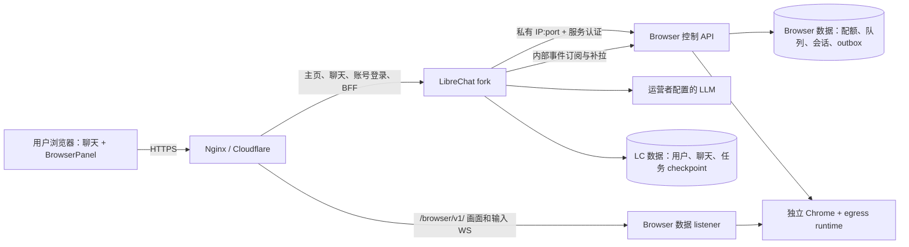

# LibreChat + Browser Service 开发方案

日期：2026-10-23（Asia/Shanghai）；容量上限更新：2026-10-24。状态：**已获实施授权，按开发计划逐项开发与验收**。

已确认：采用 LibreChat 本地账号与初始 credits，未来接入运营者提供的阿里云 Qwen LLM；首版不依赖 GitHub / Google OAuth。用户已授权生成开发计划、进度文档并持续推进开发和验收。见 [开发计划](LIBRECHAT_DEVELOPMENT.md) 与 [进度](LIBRECHAT_PROGRESS.md)。

本版取代此前“LibreChat 通过私有 MCP 接入”的设计。推荐采用 **LibreChat 原生工具 + 内置 Browser Skill + 私有 Browser API**。工作区 `deploy/librechat/` 中的 Nginx、MCP 配置及说明是上一版草稿，未安装到线上，不作为本版可执行配置。方案确认后再删除 MCP 配置片段，重新生成和验证部署文件。

## 1. 结论与产品边界

方案可行。用户在 `https://agentic-browser.zkpass.org/` 登录，使用运营者配置的 Demo Agent 和模型，在同一页面聊天、查看浏览器、接管和归还。

固定需求：

- LibreChat 本地邮箱密码账号登录后免费体验，不开放匿名聊天；每账号独立聊天记录与 credits。
- 每用户最多一个 browser session，全局最多 10 个；满额排队，展示排位并允许取消。
- Agent 操作时用户只读观看；人工操作在同屏面板内完成。
- 到号后、人工归还后，由服务端恢复原任务，无需发送“继续”。
- 只有 LibreChat 后端调用浏览器控制 API；公网关闭 MCP，也不公开通用执行 API。
- LLM 和初始 credits 由运营者配置，用户无需安装工具或提供模型 Key；未来接入阿里云 Qwen，模型与费率在实施时确认。

新主线不增加 `AB_MODE=librechat/integrated` 来维护旧模式矩阵。旧 MCP/匿名 demo 的可执行行为保留在历史 tag/镜像中；新架构复用浏览器引擎与隔离能力，替换接入层。上线后不重新开放 MCP 作为故障降级。

本期不建设多组织租户、跨主机调度、用户自建工具、永久登录 profile 或通用插件框架。10 是单机硬上限，稳定跑满的条件是压测通过。

## 2. 原生工具、Skill 与 API 的分工

| 组成 | 职责 | 不承担的职责 |
| --- | --- | --- |
| Browser Skill | 浏览流程、工具使用方法、何时请求人工接管、如何判断任务完成 | 权限、配额、资源调度、自动恢复 |
| LibreChat 原生工具 | 向模型提供类型化操作，绑定当前用户/任务，将等待交给宿主执行器 | Docker 管理、全局容量裁决 |
| 私有 Browser API | 隔离 Chrome、操作授权、控制权、画面、配额、清理和资源事件 | 模型推理、账号登录、聊天和 Agent checkpoint |

Skill 是指令和资源包，本身不能执行点击、截图或启动 Chrome。不要用“Skill 中写 curl，再给模型通用 shell 权限”替代原生工具，否则服务凭证、鉴权和等待逻辑会进入模型可操纵的脚本环境。

MCP 的主要价值是跨 Agent 客户端复用工具。现在只有固定的 LibreChat 后端，直接内部 HTTP 调用已经足够，不再需要 MCP SDK、工具发现、传输会话、headers 模板或连接缓存。未来确有外部客户端需求时可另建边缘适配器，本期不预留实现。

Skill 作为运营者发布的只读 `browser-demo/SKILL.md`，在 Demo Agent 中始终加载。固定流程放 Skill，不可违反的规则写在服务端。首版一个 Browser Skill 即可。

## 3. 架构：两个应用、两个数据所有者



**LibreChat 拥有用户和 Agent 执行状态。** 本地账号、模型配置、聊天、credits 账本、taskId、工具结果、暂停/恢复与用户停止由它管理。复用上游存储和执行器，不另写一套 Agent runner。

**Browser Service 拥有浏览器和资源状态。** 用户占位、FIFO、sessionId、控制 revision、容器、清理、viewer grant 和资源事件由它管理。它只认识可信 userId/taskId，不读 LC 数据库或保存模型历史。

原生工具和 BFF 共用一个 Browser API client。没有第三个网关、两套资源队列或两处“剩余名额”裁决。只有 controller 挂载 Docker socket；LC、前端和 Chrome runtime 均不挂载。

## 4. 项目与目录

采用两个独立仓库/checkout，各自有 lockfile、镜像、测试和发布版本。保留当前仓库位置，不把 LibreChat 源码复制进浏览器项目。

```text
/srv/agentic-demo/                         # 目标结构，尚未创建
├── repos/
│   ├── agentic-browser/                  # 当前仓库，演进为 Browser Service
│   │   ├── src/
│   │   │   ├── api/                      # 私有控制 API、schema、认证
│   │   │   ├── scheduling/               # 用户配额、FIFO、lease、outbox
│   │   │   ├── streaming/               # 只读画面、人工输入、短期 grant
│   │   │   └── ...                       # 复用 sessions / engine / runtime
│   │   ├── runtime/                      # Chrome、桌面服务、egress
│   │   ├── docs/plans/                   # 计划、协议与验收记录
│   │   └── deploy/librechat/             # 整套部署配置的源码位置
│   └── librechat-agent/                  # 独立受控 fork
│       ├── client/src/components/AgenticBrowser/
│       │   ├── BrowserPanel/             # 原生同屏面板
│       │   └── QueueStatus/              # 队列、控制权与状态展示
│       ├── api/server/routes/agenticBrowser/      # 登录态 BFF
│       ├── packages/api/src/browser/      # 遵守上游 AGENTS.md：新后端行为使用 TS
│       │   ├── tools/                    # 原生工具与可信上下文
│       │   ├── client/                   # 唯一 Browser API client
│       │   └── lifecycle/                # interrupt/resume、事件消费
│       └── skill/browser-demo/SKILL.md    # 只读技能
├── config/                               # 私有环境与渲染配置，不进入 Git
└── state/                                # 各服务独立卷，不进入 Git
    ├── librechat/
    └── browser/
```

目录名在实施时与固定上游版本对齐。暂不增加第三个 infrastructure 仓库、通用 SDK 仓库或跨项目共享数据库。内部 API schema 是协议真源；LC client 使用固定版本 schema/生成类型，禁止直接 import 另一 checkout 的源码。

LibreChat fork 的修改集中在原生面板、BFF、工具和生命周期 adapter。本地账号、基础聊天、模型 provider、权限与余额机制跟随上游。记录 upstream commit 和每组定制的契约测试。

### 4.1 本地账号与 credits（已确认）

- 复用 LibreChat 原生邮箱密码注册和登录；稳定的内部 userId 同时关联聊天、余额和浏览器占位，不以邮箱、IP 或前端提供的 header 作为身份真源。
- 启用 `balance.enabled` 与 `startBalance`，关闭 `autoRefillEnabled`；新账号获得一次初始 credits，管理员可按账号补充。刷新页面、重新登录或更换聊天不得重置余额。
- credits 按模型费率核算，不等同于原始 token 数。此前的 200,000 credits 仅是配置示例，最终初始额度需根据选定 Qwen 模型和完整 demo 的实测成本确定。
- Qwen 的模型、地域/API 接入点、输入/输出与缓存等适用费率在实施时核实；确保 Agent 多轮推理、辅助模型调用及恢复后的用量都进入同一账号账本。不为浏览器服务另建 LLM 计费系统。
- 在启动和恢复任务前检查余额；运行中结合模型输出上限和执行步数控制成本。原生余额机制不视为绝对零超额保证，P0 验证流式输出、并发请求和恢复时的扣费与停止行为。
- 是否启用邮箱验证尚未确定。允许未验证邮箱登录可省去发信配置；不配置邮件时关闭密码找回。日后启用邮件验证可使用 SMTP，无需 OAuth。
- 建议在注册/登录接入 Cloudflare Turnstile Managed 模式，并由服务端验证 token。官方免费套餐支持 20 个 widgets、每个 10 个 hostnames、无限次验证，不要求其他付费 Cloudflare 产品；本项目一个 widget 即可。尚未创建 widget 或配置密钥。
- Turnstile 用于减少自动化批量注册，不能证明一个自然人只有一个账号；注册限流与用户 credits 配额分别执行。

## 5. 同屏采用原生面板，不用 iframe

聊天区与 BrowserPanel 都是 LC React 页的一部分。LC 构建并提供全部前端资源；Browser Service 只提供画面/输入流，不再提供 `/view`、`/connect` 页面和另一套登录 UI。

因此不需要为了嵌入旧页面放宽 CSP、重写 HTML 路径、引入 postMessage、第二套登录 cookie 或一次性接管链接。旧页面的 `frame-ancestors 'none'` 不是新方案需要绕过的问题。

两种画面通道：

- **只读观察**：服务端发送受限帧率/分辨率的图片帧，协议不提供键鼠和剪贴板输入。首版优先低资源占用，不追求视频帧率。
- **人工控制**：React 面板内使用 noVNC 客户端，接现有桌面协议；服务端保证只有一个输入 owner。Agent 控制时拒绝输入，不能只靠 noVNC 的 `viewOnly` 开关。

LC BFF 校验登录和任务归属后申请短期、单次的 `observe` / `input` grant。WS 首条认证消息提交 grant，不放 URL query、日志或模型上下文；无需长期 Browser cookie。grant 绑定 user/session/revision/角色，连接期间继续校验会话和权限；注销/停用后撤销关联连接。

接管/归还通过登录态 BFF 调用内部 API。切换时撤销旧输入、fencing 旧动作。人工控制时 Agent 的观察、截图和操作继续被禁止，人类画面不回传模型。刷新或打开第二个标签页不新建 session。

## 6. 原生工具

| 工具 | 模型参数 | 宿主行为 |
| --- | --- | --- |
| `browser_open` | URL、目的 | 获取当前任务浏览器；无名额则排队并暂停；已有则复用 |
| `browser_snapshot` | 必要观察选项 | 返回规范化页面信息，必要时附截图 |
| `browser_action` | 类型化动作与参数 | 导航、点击、输入、滚动、切换标签等受控动作 |
| `browser_request_handoff` | 人工操作原因 | 切到人工控制并暂停，面板显示操作入口 |
| `browser_close` | 可选结束原因 | 请求结束当前浏览器，服务端负责清理 |

模型参数不包含 userId、服务 token、任意内部 API 地址，原则上也不包含 sessionId；宿主从当前 task 绑定取 session。模型表达操作意图，不能选择身份或其他 session。

普通聊天不占名额，首次 `browser_open` 才申请。排队时暂停执行器，LLM 不反复询问排位或重试创建，UI 直接订阅状态。输入 schema 和结果（包括截图）按选定模型/provider 做实际验证。

任务完成、停止、额度不足或过期由生命周期管理器清理，不依赖模型一定调用 `browser_close`。暂停不等于任务完成；新任务须等旧任务释放资源。

## 7. 私有 API 与身份

LC -> Browser Service 使用内部 IP:port，每次请求同时携带独立服务认证和可信 userId/taskId/conversationId/幂等标识。`X-User-ID` 可以继续作为传输字段，但由 LC 后端根据登录态生成，不能相信前端自行填写的值。conversationId 也先在 LC 验证归属。

建议 API 范围，P0 固定 schema：

| API | 用途 |
| --- | --- |
| `POST /internal/v1/leases` | 原子申请/复用资源，返回 ready 或 queued |
| `GET/DELETE /internal/v1/leases/:id` | 本人任务状态、取消排队或请求释放 |
| `POST /internal/v1/sessions/:id/actions` | 类型化浏览器动作 |
| `POST /internal/v1/sessions/:id/snapshot` | 遵守控制权的观察 |
| `POST /internal/v1/sessions/:id/control` | 接管/归还，验证 agent/human 调用语义 |
| `POST /internal/v1/sessions/:id/viewer-grants` | observe/input 短期授权 |
| `GET /internal/v1/events` 与消费确认 | 持久事件、cursor 补拉和 ack |
| `/browser/v1/sessions/:id/...` | 用户侧画面/输入 WS，仅接受相应角色 grant |

服务身份只证明“来自 LC”，user/task/session 绑定负责资源授权。它不是让所有人共用一个浏览器账号。删除新链路中的 MCP transport/sessionKey、匿名 guest 和旧私人 Agent token 依赖；所有查询、动作、grant、关闭与 WS 均检查 owner。

## 8. 网络与 Nginx

同一域名，沿用现有 Cloudflare HTTPS -> Nginx 80 拓扑。本轮不改 TLS 或在线配置。

| 路由/监听 | 目标 |
| --- | --- |
| 公网 `/`、注册登录、聊天 API、静态文件 | LC，宿主机 `127.0.0.1:3080` |
| 公网 `/api/agentic-browser/*` | LC 登录态 BFF，仍走 LC upstream |
| 公网 `/browser/v1/*` | Browser 数据 listener，宿主机 `127.0.0.1:8080` |
| 公网 `/mcp` 及子路径、`/internal/*` | 404，没有到控制 API 的代理 |
| 旧 `/view`、`/connect`、匿名 claim/start | 退休，不透明映射到新 API |
| 私有控制 API | Docker 控制网 IP:3335，不发布宿主机端口 |

Browser Service 在**同一进程**持有控制和数据两个 listener，不是两个微服务。Nginx 无法转发到控制 listener；数据 listener 自身也只有画面/输入 allowlist。这个分离服务于权限边界，与兼容 MCP 无关。

Docker 中 LC API 和 controller 共用专用控制网，例如 `172.30.240.2:3335`，实施前检查冲突；runtime/egress 不加入。LC API 另接可访问 LLM 与 Turnstile 验证服务的网络。若两服务均作为宿主机进程运行，内部 API 可用 `127.0.0.1:8081`；容器内 localhost 不是宿主机。

Nginx 保留 SSE 流式转发、WS Upgrade 和长连接超时，清除外来可信上下文头，保留 LC 正常 Authorization/Cookie。不在代理实现用户配额，不重写 HTML，不绕公网调用内部 API。方案确认后重新生成配置并隔离验证，才安排切换。

## 9. 配额与队列只有一份实现

Browser Service 用本地持久数据库与事务裁决容量，建议独立 `scheduler.sqlite`。单 controller / 单 Docker host 暂不用外部资源队列或消息总线；若 LC 固定版本需要 Redis 承载持久 checkpoint，它只属于 LC 执行层。

不变量：

- 每用户最多一个占位/session，全局最多 10。计数包括 reserved、starting、active、closing、cleanup_pending。
- 每人最多一条排队记录；已有占位不能再排一条。换聊天、标签页或模型不能获得第二份额度。
- FIFO、取消、过期、无插队；同一个 `(userId, taskId, acquisitionId)` 重试返回同一结果。
- 先原子预留，再创建容器；确认清理完成后才释放。失败/超时不产生假空位。
- 同用户在另一聊天申请时提示已有任务，不自动把旧 session 转给新聊天。
- 全局硬上限 10；资源压力允许暂停分配。排位和空位显示是快照，不是预留凭证。

建议初值：排队 10 分钟、预留领取 30 秒、启动 90 秒；浏览器初始 5 分钟、最长 10 分钟，排队不消耗运行时长。P0/压测后再确定。

Browser 存 QueueTicket、SlotLease、SessionBinding、EventOutbox；LC 存 Task 和 Agent checkpoint。通过 ID 关联，不复制对方的状态机；跨服务取消用幂等请求和事件重试，不引入分布式事务。

## 10. 自动暂停和恢复

排队与人工接管复用同一种执行能力的两个等待原因：`waiting_for_slot`、`waiting_for_human`。原生工具触发宿主 interrupt/checkpoint，Browser Service 发出 `slot_ready` 或 `control_returned`，LC 后端消费并恢复原工具和任务。

不用无限 HTTP 等待，也不靠前端自动发送“继续”。关闭网页不能丢失服务端任务。

已核对的上游 `ask_user_question` 使用 interrupt/checkpointer，可作为扩展参考，但不是现成 browser resume API。P0 必须验证自定义等待类型与持久恢复。上游还明确说明恢复时工具函数从头执行，同批 sibling tools 也可能重跑，所以必须：

1. 服务端串行执行 Browser 工具；暂停工具不得与副作用工具并行。无效 batch 在任何副作用前拒绝/安全拆分，不能只靠提示词。
2. 使用持久 task/toolCall ID 生成稳定 acquisition/handoff/action ID；重入读取已完成结果，不重新创建、接管或提交网页。
3. checkpoint 绑定 user、conversation、task、generation/branch、toolCall、session 和 revision，仅恢复正确 owner、分支与等待状态。
4. Browser outbox 持久化；LC 后端主动订阅、补拉、ack。事件早到、重复、乱序或暂时失败均可重试，以 session/revision/eventType 去重。
5. 归还先撤销人工输入、切回 Agent，再发事件。用户停止、额度不足、会话过期、权限撤销或迟到事件都不能重新唤醒已终止任务。

采用至少一次事件投递与幂等任务接纳，不承诺网页动作 exactly-once。动作结果不确定时检查状态，禁止自动重放提交。

LC 重启而浏览器仍在时通过 checkpoint/outbox 恢复。Browser Service 重启导致旧浏览器被清理时，结束对应任务并提示重开；不能假装恢复不存在的 session。本期不承诺 Chrome 跨 controller 重启保活。

## 11. 复用与退休

| 复用 | 重构或退休 |
| --- | --- |
| Chrome 隔离、Playwright/CDP、egress 限制 | 公共/私有 MCP 与 stdio 入口退出新运行路径 |
| sessions 控制权、revision、动作串行与清理不变量 | IP 业务配额改为稳定用户配额，IP 仅保留网络防滥用用途 |
| runtime ledger、启动/退出清理、资源限制 | 匿名 guest/sessionKey/claim-link 接入机制退休 |
| RFB/noVNC 服务端基础、单输入 owner | 旧独立网页与另一套登录/安装配置向导退休 |
| 有效的资源隔离与权限测试 | 旧 MCP 客户端和旧模式矩阵测试保留在历史版本或删除 |

不先保留所有旧模式再层层适配。新入口直接使用用户/任务归属，复用内部能力而非旧凭证格式。迁移是明确版本边界；当前线上仍运行旧版本，方案确认和实施前不删除其配置。

## 12. 开发阶段

| 阶段 | 工作 | 验收门槛 |
| --- | --- | --- |
| P0 技术验证 | 固定 LC commit；本地账号与 credits；一个原生工具/只读 Skill；内部 API 原型；持久暂停/恢复；原生面板接帧流 | 双账号及账本隔离；模型费率与完整任务用量核对；余额不足阻止继续；超过 HTTP timeout 后恢复；工具重入不重复动作 |
| P1 API 与身份 | 双 listener、服务认证、user/task/session 归属、角色 grant；新主线退出 MCP | 公网控制 API 不可达；伪造身份与跨用户动作/WS 失败 |
| P2 配额与事件 | 每人 1、全局 10、FIFO、取消、租约、失败清理、outbox | 11 人最多占 10；同用户并发只占 1；不超卖 |
| P3 LC 与同屏 | BrowserPanel、QueueStatus、BFF、原生工具、Skill | 只读不可控；human 时 Agent 不可观察/操作；刷新不新建 session |
| P4 自动恢复 | 等待类型/checkpoint、事件消费、去重、取消竞争、重启 | 到号/归还无需发消息；原任务/聊天/分支；不重复提交 |
| P5 压测发布 | 1/5/10 分档、Qwen 模型预算、本地注册与防滥用、Nginx 切换、入口退休和回滚 | 真实 workload 通过或扩容；新用户额度仅初始化一次；无旧 MCP/匿名旁路 |

P0 优先验证自动恢复，不能因上游有暂停工具就假定接入简单。初步量级约 3–5 周单工程师工作，P0 后收敛，不作为上线承诺。

关键验收覆盖：跨用户全部 API/WS、同用户多聊天、11 人竞争、取消与分配竞争、启动/清理失败、只读输入攻击、旧 grant/revision、工具重入、事件早到/重复/乱序、停止与归还竞争、额度不足、LC 与 Browser 各自重启。

## 13. 容量与发布

本次工作主机约 4 vCPU / 15 GiB RAM，并运行其他服务；最终生产机是否相同在 P0 确认。当前每浏览器上限 2 GiB / 2 CPU，每代理 128 MiB / 0.5 CPU，这是上限而非实际占用。10 组内存上限合计约 21.25 GiB，另有 LC/数据库开销，不能承诺当前主机跑满。

压测观察启动耗时、动作/画面延迟、CPU/RSS、OOM、错误率和清理速度。最大配置 10，实际放行由资源 admission gate 控制；未测通过不得声称稳定支持 10 并发。

发布顺序：固定版本/私有配置 -> 私网验收 -> 停旧站新会话 -> 排空/清理 -> 备份 -> 启目标 listener -> 安装新 Nginx 并 `nginx -t` -> reload -> 公网双账号完整任务。旧匿名 session/cookie 不迁移为 LC 用户。

回滚到上一份验收过的集成版本；首次迁移失败时进入维护页。保持公网 MCP 关闭，不退回开放匿名 MCP。数据/镜像/配置成套备份，不重放未知网页提交。

## 14. 依据与待确认事项

- [LibreChat Skills](https://www.librechat.ai/docs/features/skills)：只读部署技能与执行工具的分工。
- [LibreChat 账号配置](https://www.librechat.ai/docs/configuration/authentication)、[余额配置](https://www.librechat.ai/docs/configuration/librechat_yaml/object_structure/balance)、[计费说明](https://www.librechat.ai/docs/configuration/token_usage)：本地账号、初始 credits、模型费率与余额管理。
- [Cloudflare Turnstile 套餐](https://developers.cloudflare.com/turnstile/plans/)：免费套餐独立于其他 Cloudflare 付费服务；额度以实施时官方说明为准。
- [原生 ToolService](https://github.com/LibreChat-AI/LibreChat/blob/61892206974618971b9001d109485d994dac2816/api/server/services/ToolService.js)：原生工具注册源码参考。
- [原生暂停工具](https://github.com/LibreChat-AI/LibreChat/blob/61892206974618971b9001d109485d994dac2816/packages/api/src/agents/hitl/askUserQuestionTool.ts)：interrupt/checkpointer、重入和并行约束。
- [上游事件机制](https://github.com/LibreChat-AI/LibreChat/blob/61892206974618971b9001d109485d994dac2816/packages/api/src/agents/triggers/README.md)：持久投递与去重参考。
- 本项目 sessions、desktop-gateway、http-origin、docker-runtime 和实际 Nginx/容器检查。

commit 是研究参照，不是已批准生产版本。在线文档标注 Latest (dev)，实施前验证固定版本。

实施基线：**不使用 MCP；原生工具 + 只读 Skill；原生同屏面板；Browser 统一配额；LC 统一执行；旧接入层在版本切换时退休。** LC 的 `api/` 只做 Express 接线，新后端行为放 `packages/api`，共享协议与配置放 `packages/data-provider`，遵守固定版本上游 AGENTS.md。

实际开发、测试和部署状态以进度文档为准。只有通过相应验收才能标记完成；真实 Qwen、公开注册防滥用和 10 浏览器压力验收不得用模拟测试替代。


## 15. 已实施补充：全站预算、管理与找回

2026-10-25（北京时间）按用户选择新增每日 **20,000,000 credits**，以 Asia/Shanghai 零点划分账期，个人赠额保持 200,000 且不自动补充。它与 Browser 并发配额独立：Browser 继续管理每人一个、运行 5 / 硬上限 10；LC 管理所有账号和模型费用。

LC 的 Mongo `SiteBudget` 保存全站额度、每日已用/预留/不确定成本、持久请求 hold 和额度修改审计。Qwen transport 在每次请求（含标题与恢复）前原子预留，已知 usage 后幂等结算；没有 usage 保守计费，崩溃遗留 hold 不自动返还。模型和费率必须受部署配置控制，文本上下文与输出上界固定；管理员降低预算不取消已在途请求。总额按 credits 费率核算，不是阿里云账单级开关，也不覆盖其他应用用同一 key 的调用。

管理 `/demo-admin` 由 LC 登录态和每请求 ADMIN 校验保护，普通用户无权访问管理 API。预算修改采用 revision 比较，给普通本地账号充值采用幂等 ID，审计与增额在同一 balance 文档原子提交。前端只调用 LC 的管理接口，Browser 项目不建立第二套用户数据库。

邮件复用 LC 原生密码找回，Cloudflare Email Sending SMTP 负责发送，使用已验证子域名地址。密钥与邮箱放私密部署文件，一次测试成功的配置指纹才允许启用找回。重置链接 15 分钟、服务端即时过期检查、原子单次消费、限流和同源保护；重置后旧登录失效且 credits 保留。邮件收据只证明 Cloudflare 接受，收件箱确认单独记录。

实现归属：`packages/api/src/budget/` 为 transport/管理行为，`packages/data-schemas` 为持久化，`packages/data-provider` 为配置和协议，`client/src/components/Demo` 为管理 UI；Browser 仓库仅补部署、验收和文档。未引入 MCP、OAuth 或额外账号服务。
